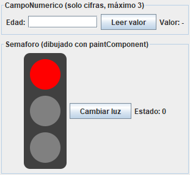
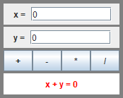
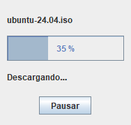
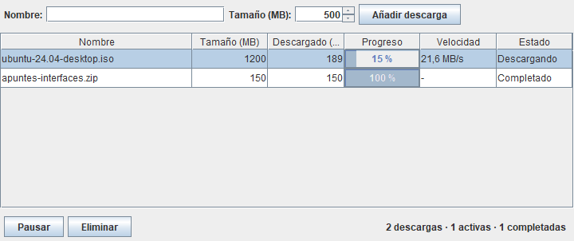

# Cómo es el examen y cómo usar esta guía

## El examen

| Parte | Qué es | Qué hay que llevar preparado |
|---|---|---|
| Test | 20 preguntas, 4 opciones. Cada fallo resta 0,33. En blanco no resta. | Partes I y II de esta guía y el banco de preguntas |
| Práctica 1 | Componentes: cómo se hace un componente | Parte III |
| Práctica 2 | Una interfaz con Java Swing. Simulada (tipo BitTorrent) o con una función sencilla que sí funcione (tipo calculadora) | Parte IV |

No hay enunciado publicado. Lo único mandado en clase son dos ejercicios: la calculadora en NetBeans y un torrent que simule descargas. Por eso la parte práctica de esta guía gira en torno a esos dos.

## Cómo usar la guía

1. Lee cada tema una vez entero. Los recuadros **«Pregunta de test»** marcan los datos que más se prestan a pregunta: listas cerradas, fechas, autores, números.
2. Haz el banco de preguntas del final de la Parte II sin mirar. Apunta las que falles y vuelve al tema.
3. Para la práctica, no leas el código: escríbelo. Abre NetBeans y repite la calculadora y el torrent mínimo hasta que salgan sin mirar.
4. La chuleta del final es para el último repaso, no para estudiar de ella.

Los proyectos de apoyo están en la carpeta `examen/` del repositorio y se abren en NetBeans con *File → Open Project*:

- `examen/componentes-propios/`: los dos componentes de la Parte III y una ventana de prueba.
- `examen/simulador-torrent/`: el torrent mínimo y el completo de la Parte IV.
- `unidad-2-editores-visuales-netbeans/calculadora-simple/`: la calculadora.

Todo el código de esos proyectos está comentado línea a línea. En esta guía aparece resumido para que quepa en la página.

## Estrategia para un test que resta

Con 4 opciones, acertar suma 1 y fallar resta 1/3. Lo que importa es cuántas opciones puedes descartar con seguridad:

| Situación | Probabilidad de acertar | Ganancia media por pregunta | Qué hacer |
|---|---|---|---|
| No descartas ninguna | 1 de 4 | 0,25 − 0,75 × 0,33 = **0** | Da igual de media. Mejor en blanco: no ganas nada y te evitas la mala suerte |
| Descartas una | 1 de 3 | 0,33 − 0,67 × 0,33 = **+0,11** | Contesta |
| Descartas dos | 1 de 2 | 0,50 − 0,50 × 0,33 = **+0,33** | Contesta siempre |
| La sabes | 1 | **+1** | Contesta |

La regla práctica: **si puedes descartar al menos una opción con seguridad, contesta.** Si las cuatro te parecen igual de posibles, déjala en blanco.

Tres fallos se comen un acierto. Si contestas las 20 y fallas 6, te quedas en 14 − 2 = 12 sobre 20, un 6. Si en esas 6 hubieras dejado en blanco las 3 que eran lotería y acertado una de las otras, estarías igual o mejor.

Orden recomendado: primera vuelta contestando solo las seguras, segunda vuelta para las que permiten descartar, y las de lotería se quedan en blanco.

> El valor exacto de la penalización (0,33) es el que se entendió en clase. Confírmalo con el profesor antes del examen: si restara 0,25, convendría contestar todas; si restara 0,5, solo las que permiten descartar dos.

# Parte I. Teoría: interfaces de usuario y usabilidad (Unidad 1 y 4)

La teoría de la Unidad 1 y 4 es el curso *Interfaces de Usuario* de la UC3M (temas 1 a 5) más el documento de psicología de los colores.

## Tema 1. Interacción persona-ordenador (IPO)

### Idea central

Un producto interactivo se diseña pensando en quién lo va a usar, qué tareas sabe hacer bien y mal, y dónde lo usará. Para saberlo hay que **observar y escuchar al usuario**.

### Factores para que un objeto se pueda usar

| Factor | Qué significa | Ejemplo |
|---|---|---|
| Visibilidad | Los controles se ven | Un botón que no está escondido en un submenú |
| Causalidad | Se ve el efecto de lo que haces | Pulsas y algo cambia de inmediato |
| Restricciones visibles | El diseño impide el uso incorrecto | Una puerta que solo se puede empujar por un lado |
| Coincidencia (*mapping*) | Relación natural entre el control y su efecto | Los mandos de los fogones colocados como los fogones |
| Efectos de transferencia | Lo aprendido en un objeto se aplica a otro | De la máquina de escribir al procesador de textos |
| Estereotipos | Símbolos que todos entendemos aunque ya no representen la realidad | El icono del teléfono con auricular |
| Modelos conceptuales | La idea que la gente tiene de cómo funciona algo. Puede ser errónea | Creer que subir más el termostato calienta más rápido |
| Diferencias individuales y culturales | No todos los usuarios son iguales | Colores con distinto significado según el país |

Los controles tienen que ser **visibles**, mostrar bien sus **efectos** (causalidad) y **sugerir su función** (*mapping*).

### Historia y definiciones

- Primero se llamó *Man-Machine Interface*. A mediados de los 80 aparece el término **HCI** (*Human-Computer Interaction*) o CHI.
- Definición de **ACM SIGCHI (1987)**: disciplina relacionada con el **diseño, la evaluación y la implementación** de sistemas interactivos para el uso humano, y con el estudio de los fenómenos que los rodean.
- La IPO es **multidisciplinar**.

| Año | Hito (según los apuntes) |
|---|---|
| 1963 | Primer ratón (Douglas Engelbart, Stanford) |
| 1968 | *The Demo* de Engelbart |
| 1981 | Primer dispositivo comercial con ratón: Xerox Star 8010 |
| 1984 | Primer ordenador comercial con éxito: Apple Lisa |

> **Ojo con 1984.** Los apuntes dicen «Apple Lisa». Históricamente el Lisa es de 1983 y el que triunfó en 1984 fue el Macintosh. Si en el test aparece, responde lo que dicen los apuntes.

### Objetivos de la IPO

Desarrollar o mejorar en un sistema:

- **Seguridad**
- **Utilidad**: qué puede hacer el sistema
- **Efectividad**
- **Eficiencia**: el botón más usado, el más cercano
- **Usabilidad**: fácil de usar, fácil de aprender y libre de errores

### Vocabulario del modelo de interacción

| Término | Definición | Ejemplo |
|---|---|---|
| Dominio | Área de habilidad y conocimiento del mundo real | Administración pública |
| Meta | **Qué** quiere conseguir el usuario | Realizar una solicitud |
| Tarea | **Cómo** conseguir la meta con un dispositivo concreto | Por carta o por email |
| Acción | Tarea que no implica resolver problemas ni estructuras de control | Redactar, franquear, enviar |
| Plan | Conjunto de tareas para conseguir una meta | Comprar sobre, escribir destinatario, comprar sello |

### Modelo de Norman (ejecución y evaluación)

Don Norman, *The Design of Everyday Things* (1988). Es quien habla de **Diseño Centrado en el Usuario**. El usuario formula un plan, lo ejecuta en la interfaz y luego observa el resultado para evaluar si necesita más acciones.

Siete etapas:

| | Ejecución | | Evaluación |
|---|---|---|---|
| 1 | Establece la **meta** | 5 | **Percibe** el estado del mundo |
| 2 | Formula la **intención** | 6 | **Interpreta** el estado del mundo |
| 3 | **Especifica** las acciones | 7 | **Evalúa** el estado respecto a la meta |
| 4 | **Ejecuta** las acciones | | |

Dos lenguajes: el **del sistema** (lenguaje del núcleo, atributos computacionales) y el **del usuario** (lenguaje de la tarea, atributos psicológicos).

Por qué fallan las interfaces:

- **Abismo (golfo) de ejecución**: diferencia entre las acciones que el usuario formula y las que el sistema permite. Ejemplo: quiero «grabar» y el sistema me obliga a elegir canal, duración y confirmar.
- **Abismo (golfo) de evaluación**: distancia entre cómo el sistema presenta su estado y lo que el usuario esperaba. Ejemplo: tras pulsar grabar, nada indica que esté grabando.

Dos distancias:

- **Distancia semántica**: entre el significado de los elementos de la interfaz y el **objetivo** del usuario.
- **Distancia articulatoria**: entre el significado de los elementos y su **representación física**.

**Modelo de Abowd y Beale**: amplía el de Norman incluyendo la **interfaz de usuario de forma explícita**, como traductora entre el lenguaje del usuario y el del sistema.

> **Pregunta de test.** El modelo de Norman tiene 7 etapas: 4 de ejecución (contando la meta) y 3 de evaluación. Si te preguntan cuál NO es una etapa, busca una que no sea meta, intención, especificar, ejecutar, percibir, interpretar o evaluar.

### Interfaz de usuario

Es el **canal** por el que se comunican usuario y ordenador. Tiene dos caras:

- **Lógica**: utilidad y usabilidad (sistemas y aplicaciones).
- **Física**: ergonomía (dispositivos).

Los tres «héroes» de la IPO que citan los apuntes: **Don Norman**, **Ben Shneiderman** y **Steve Jobs** («el diseño no es solo cómo se ve, es cómo funciona»).

## Tema 2.1. Tipos de interfaces de usuario

Nueve tipos:

| Tipo | Lo esencial |
|---|---|
| 1. Comandos | Terminal. Eficiente, precisa y veloz, pero difícil de aprender. Alternativa para personas con discapacidad visual |
| 2. WIMP y GUI | Ventanas, iconos, menús y puntero. La primera WIMP la diseñó **Xerox** |
| 3. Multimedia | Combina varios medios. Mejora el aprendizaje y la aceptación |
| 4. Realidad virtual | Simulación gráfica con sensación de presencia. Simuladores de vuelo |
| 5. Tableros | Visualizar datos complejos y reconocer patrones o anomalías |
| 6. Móvil | Pantalla pequeña, multitáctil, uso en movimiento |
| 7. Voz | Siri, Alexa. Útil para información concreta y para accesibilidad |
| 8. Compartida | Varios usuarios y varias entradas a la vez. Pantallas grandes o mesas |
| 9. Cerebro-ordenador | Comunicación entre ondas cerebrales y un dispositivo. Requiere entrenamiento |

**WIMP** = **W**indows, **I**cons, **M**enus, **P**ointing device.

### Ventanas

Se inventaron para superar el límite físico de la pantalla. Formas de organizarlas:

- ***Tiled*** (en mosaico): permiten arrastrar y soltar.
- ***Overlapping*** (solapadas): aprovechan todo el espacio pero pueden volverse inmanejables.
- ***Cascading*** (en cascada): aprovechan el espacio y facilitan la organización.

### MDI, SDI y TDI

| | MDI (*Multiple Document Interface*) | SDI (*Single Document Interface*) | TDI (*Tabbed Document Interface*) |
|---|---|---|---|
| Centrada en | La **aplicación** | El **documento** | Variante de MDI con **pestañas** (*workbook*) |
| Cómo funciona | Una ventana principal contiene todos los documentos | Una ventana principal nueva por cada documento | Se cambia de documento con pestañas |
| Ventajas | Conserva recursos, espacio de trabajo coordinado, varios documentos a la vista | Menús y barras reflejan lo que ve el usuario, menos complejidad visual | |
| Desventajas | Los menús cambian según el documento, las ventanas hijas no salen del área de trabajo (se pierde la ventaja de varias pantallas) | No se pueden agrupar documentos relacionados, la barra de tareas se llena, cambiar de ventana es más difícil | |

### Cajas de diálogo

Espacio para funciones relacionadas pero secundarias: propiedades de un objeto, ejecutar procesos, confirmar acciones, alertar de errores.

- **Modal**: el usuario **no puede hacer otra cosa** hasta cerrarla.
- **No modal**: puede seguir usando el resto del programa.

### Otros elementos

- **Paneles**: agrupación visual de funciones relacionadas. Acceso sin menús.
- **Marcos** (*frames*): se minimizan y cambian de tamaño.
- **Pestañas**: permiten más contenido apilando niveles. Las pestañas apiladas en varias filas rompen la consistencia porque cambian de sitio.

### Iconos

Más fáciles de aprender y recordar que los comandos. La correspondencia entre el icono y lo que representa puede ser:

| Tipo | Ejemplo |
|---|---|
| **Similar** | La imagen de un fichero para un fichero |
| **Analógica** | Unas tijeras para «cortar» |
| **Arbitraria** | Una X para «borrar» |

### Menús

- **Lista**: pocas opciones, todas visibles a la vez.
- **Expandible**: muchas opciones (menú en cascada).
- **Contextual**: las opciones dependen de la tarea en curso.

Guías de diseño de fabricante: Apple *Human Interface Guidelines*, Microsoft *UX checklist*, Google *Material Design*.

## Tema 2.2. Usabilidad

### Definiciones

- **Miller**: propiedad que refleja la facilidad de uso de un sistema.
- **Nielsen**: calidad basada en **5 componentes**: facilidad de aprendizaje (*learnability*), eficiencia, facilidad de recuerdo (*memorability*), errores y satisfacción.
- **Bevan**: nivel de **eficacia, eficiencia y satisfacción** que alcanza un producto usado por una clase de usuarios para lograr unos objetivos en un entorno específico.

**Usabilidad no es experiencia de usuario (UX).** La usabilidad es un atributo de calidad de la interfaz. La UX es más amplia: abarca toda la interacción del usuario con la empresa, sus servicios y sus productos.

Las **metáforas** (papelera, carpeta) ayudan, pero pueden tener problemas de internacionalización. Hay que evaluarlas con usuarios.

### El ser humano

**Percepción visual.** El tamaño y la profundidad percibidos dependen del **ángulo visual**.

Leyes de la **Gestalt** («el todo es diferente de la suma de las partes»):

- **Cierre**: completamos con la imaginación las formas incompletas.
- **Figura y fondo**: el fondo enmarca a la figura y tiende a no percibirse.
- **Simplicidad**: percibimos los elementos de la forma más simple.

**Brillo**: cantidad de luminancia percibida (subjetivo). **Contraste**: relación entre la iluminación de un cuerpo y la de su fondo.

**Color**: se compone de **matiz** (longitud de onda), **intensidad** (brillo) y **saturación** (cantidad de blanco).

- Usar entre **5 y 7 colores**. Los grises claros son los mejores fondos.
- El color sirve para categorizar, diferenciar o destacar, **no para dar información adicional**.
- La interfaz debería poder usarse en blanco y negro. Son daltónicos el **8 % de los hombres** y el **1 % de las mujeres**.
- Colores **fríos**: calma y profesionalidad. **Cálidos**: pasión, alegría, energía.
- **Complementarios**: opuestos en el círculo cromático, generan fuerte contraste. **Análogos**: vecinos en el círculo, base de los esquemas armónicos.

**Memoria:**

| Tipo | Características |
|---|---|
| Sensorial | Icónica, ambiental y del tacto |
| Corto plazo | Fugaz y limitada: hasta **30 segundos** y **7 ± 2 elementos** |
| Largo plazo | Tiempo indefinido y capacidad ilimitada |

**Razonamiento:**

| Tipo | Qué es | Ejemplo de los apuntes |
|---|---|---|
| Deductivo | Derivación lógica | Pedro es una persona; las personas comen pescado; Pedro come pescado |
| Inductivo | Generalizar a partir de casos | Veo un avión con hélices; todos los aviones las tienen |
| Abductivo | Explicar un efecto observado | Santi corre cuando bebe; lo veo correr; ha bebido |

### Beneficios de la usabilidad

Menos costes de aprendizaje, menos costes de asistencia, más aceptación, mejor imagen, mejor calidad de vida, menos costes de producción y más productividad.

### Principios de diseño

Son abstracciones generalizables que orientan al diseñador. Vienen de la teoría, la experiencia y el sentido común. **No existe una regla de oro.**

- Entender al usuario y el dominio.
- Claridad y simplicidad.
- Visibilidad de controles y opciones.
- **Consistencia**: resultados similares del mismo modo. Ejemplo de inconsistencia: el teclado numérico del teléfono (1-2-3 arriba) frente al de la calculadora (7-8-9 arriba).
- Pistas visuales y auditivas.
- Organización lógica: los más usados, más cerca.
- Ocultar o desactivar lo que no se puede usar en el estado actual.
- *Feedback* sobre el estado del sistema.
- Legibilidad y soporte de teclado.

**Mensajes de error**: específicos («Falta el paréntesis izquierdo» en vez de «Error de sintaxis»), constructivos, en tono positivo y centrados en el usuario.

### Cuatro tipos de artefactos de diseño

| Artefacto | Definición |
|---|---|
| **Heurísticas** | Abstracciones generalizables basadas en la experiencia, el sentido común o la teoría |
| **Guías de diseño** | Recomendaciones basadas en la **experimentación** |
| **Patrones de diseño** | Soluciones **probadas** a problemas **recurrentes**, recopiladas de forma sistemática |
| **Métodos de inspección** | Procedimientos para **evaluar** una interfaz y determinar su grado de usabilidad |

### Las 10 heurísticas de Nielsen

Nielsen las formuló tras estudiar **249 problemas de usabilidad**.

| Nº | Heurística | En una calculadora o un torrent |
|---|---|---|
| 1 | Visibilidad del estado del sistema | Barra de progreso y columna «Estado» |
| 2 | Coincidencia entre el sistema y el mundo real | Botones +, −, ×, ÷ como en una calculadora real |
| 3 | Control y libertad del usuario | Pausar, reanudar, botón C para borrar |
| 4 | Consistencia y estandarización | Todos los botones iguales y en el mismo orden |
| 5 | Prevención de errores | Desactivar «Pausar» si no hay fila seleccionada |
| 6 | Reconocimiento antes que recuerdo | Opciones visibles, no comandos que memorizar |
| 7 | Flexibilidad y eficiencia de uso | Intro en el campo de texto añade la descarga |
| 8 | Estética y diseño minimalista | Solo los controles necesarios |
| 9 | Ayudar a reconocer, diagnosticar y recuperarse de errores | «No se puede dividir entre cero» |
| 10 | Ayuda y documentación | *Tooltips*, menú Ayuda |

> **Pregunta de test.** Son 10 y salen en tres temas distintos (2.2, 3.2 y 4.2). Apréndelas de memoria. Truco: 1 a 3 hablan de la relación sistema-usuario (estado, mundo real, control), 4 a 6 de no hacer pensar (consistencia, prevenir, reconocer), 7 y 8 de eficiencia y limpieza, 9 y 10 de cuando algo va mal (errores y ayuda).

### Patrones de diseño

- Años **70**: los propone **Christopher Alexander** en arquitectura y urbanismo.
- **1987**: llegan a la programación orientada a objetos.
- **1998**: llegan a la comunidad HCI (*usability patterns*).

Capturan **prácticas, no teoría**. Formato de un patrón: nombre, problema, solución, discusión de ventajas y desventajas, ejemplos y patrones relacionados.

## Tema 2.3. Metodología y prototipado

### Proceso de diseño (Dix)

Qué se quiere (requisitos) → análisis → diseño → prototipo (evaluar e iterar) → implementar y desplegar.

### Conocer al usuario

- ***Stakeholders***: usuarios afectados **directa o indirectamente** por el sistema.
- **Persona**: descripción detallada de un **usuario típico**: objetivos, capacidades, actitudes, tareas y contexto.
- **Métodos etnográficos**: observar a las personas en su contexto real.
- **Escenarios**: historias detalladas de cómo funciona la interacción.

### Diseño centrado en el usuario (DCU)

El usuario está en el centro del proceso, para minimizar su esfuerzo cognitivo. Cuatro fases que se repiten:

1. **Requisitos del usuario**: entender el contexto de uso (quién, para qué, en qué condiciones).
2. **Análisis**: especificar requisitos con entrevistas, grupos focales, encuestas.
3. **Diseño**: producir soluciones mediante prototipos sucesivos.
4. **Evaluación**: validar los prototipos. Los apuntes la llaman **la fase más importante**.

Tres ideas enlazadas: el **modelo mental del diseñador**, la **imagen del sistema** (lo que el diseñador plasma en la interfaz) y el **modelo mental del usuario** (lo que el usuario interpreta). El problema aparece cuando la idea del diseñador no coincide con la del usuario.

### Prototipos

Un prototipo puede ser: bocetos de pantallas, un *storyboard*, una presentación, un vídeo, un objeto físico, un *mock-up* en papel o un sistema con funciones limitadas.

Sirve para evaluar la idea, recibir *feedback* y tomar decisiones de diseño.

***Rapid prototyping***, tres fases que se iteran: **definir**, **evaluar** y **redefinir**.

Cuatro cualidades de un prototipo: **representación** (forma física), **fidelidad** (nivel de detalle), **interacción** y **evolución** (ciclo de vida).

Fidelidad:

- **Funcional → prototipo horizontal**: muchas funciones con poco detalle.
- **Visual → prototipo vertical**: pocas funciones con mucho detalle.

| Visual | Funcional | Qué es | Para qué |
|---|---|---|---|
| Baja | Baja | Prototipo en **papel** | Primeras fases, definir funciones y requisitos |
| Baja | Alta | ***Wireframes*** | Evaluar usabilidad, pruebas de concepto |
| Alta | Baja | ***Mock-ups*** | Evaluar el flujo del sistema |
| Alta | Alta | Prototipo ***Hi-Fi*** | Último paso antes del producto final (Axure, InVision, Sketch) |

## Tema 2.4. Accesibilidad

### Conceptos

- **Tecnología adaptativa** (*assistive technology*): productos diseñados para **mejorar o aumentar las capacidades** de personas con discapacidad. Lectores de pantalla, pantallas Braille, magnificadores, teclados adaptados, ratón de pie.
- **Diseño universal** (Mace, 1991): productos usables por todos **sin necesidad de adaptarlos**.
- ***Design for All***: engloba diseño accesible, inclusivo, sin barreras y universal. Accesibilidad y usabilidad se tienen en cuenta durante todo el proceso.
- La **accesibilidad es un prerrequisito de la usabilidad**.

### Los 7 principios del diseño universal

1. Uso **equitativo**
2. Uso **flexible**
3. Uso **simple e intuitivo**
4. Información **perceptible**
5. **Tolerancia al error**
6. **Mínimo esfuerzo físico**
7. **Tamaño y espacio** de aproximación y uso

### Factores de diversidad

**Diversidad de usuarios:**

- **Discapacidad**: de percepción (visual, auditiva), de movimiento (física) y de cognición.
- **Edad**: niños y mayores.
- **Experiencia** con la tecnología.
- **Cultura**: idioma, símbolos, colores (el verde es sagrado en el Islam; el amarillo, en el Budismo).
- **Social**: clase y educación.

**Diversidad tecnológica**: el entorno puede ser un impedimento (ruido, oscuridad). Un usuario puede estar **temporalmente discapacitado** por su contexto.

### Accesibilidad web

| Guía | Para qué |
|---|---|
| **WCAG** (*Web Content Accessibility Guidelines*) | Hacer accesible todo el contenido web. Tres niveles de cumplimiento: **A, AA y AAA** |
| **WAI-ARIA** | Hacer accesibles el **contenido dinámico** y los controles avanzados (JavaScript) |

Herramientas: **TAW** (Test de Accesibilidad Web), validador de W3C, WebAIM.

### Técnicas de interacción para la accesibilidad

- **Voz**: de salida (lector de pantalla), de reconocimiento (dictado) y de diálogo hablado (ambas).
- **Háptica**: tacto activo. Braille, vibración.
- **Escaneo**: un marcador recorre la interfaz y el usuario activa un interruptor.
- ***Eye-tracking***: la mirada selecciona.
- **Gestos y cabeza**.
- **Interfaces cerebrales**: **invasivas** (sondas dentro del cerebro) o **no invasivas** (electrodos externos).
- **Lengua de signos**.
- **Multimodales**: dos o más modos de entrada.

## Tema 3. Diseño web

### Principios básicos

- Diseñar para las necesidades del usuario.
- **Evitar la navegación lineal**.
- El usuario debe saber siempre **dónde está, qué puede hacer y cómo ir a otros contenidos**.
- Facilitar la búsqueda.

Tres aspectos del diseño de un sitio: **estructura, navegación e interacción**.

### Estructura

- **Anchura antes que profundidad** (*first width, then depth*).
- Tres niveles: página principal → secciones principales → subsecciones.
- La **página principal** responde a «¿dónde estoy?» y «¿de qué va esta web?».

### Navegación

Tres preguntas: **¿Dónde estoy? ¿Dónde he estado? ¿Dónde puedo ir?**

Tipos de enlaces:

| Tipo | A dónde llevan |
|---|---|
| **Estructurales** | A otras páginas del mismo sitio. Definen su estructura |
| **Asociativos** | A otros contenidos de la **misma página** |
| **Embebidos** | A otras páginas o a otros sitios. Información adicional |

Según Nielsen, lo que hace que un enlace parezca un enlace es el **color azul**.

Ayudas a la navegación: visita guiada, mapa del sitio, directorios, migas de pan, ayuda, búsqueda, metáforas.

### Página

- Contenido por encima de estética y navegación. Separar contenido de presentación.
- ***Scroll***: lo importante arriba. Pocos desplazamientos verticales. **Nunca *scroll* horizontal**.
- **Widget**: componente software que da información visual y facilita una interacción concreta.

### Contenido

- Tiempo de descarga **inferior a 1 segundo**, máximo 10.
- Texto corto, sin párrafos introductorios, con tablas y listas, sin jerga.

### Utilidad frente a usabilidad

La **utilidad** se refiere solo al uso que se hace del sistema. La **usabilidad** incluye la utilidad y además eficiencia, seguridad, facilidad de recuerdo, de aprendizaje y satisfacción.

### Legibilidad

- Alto contraste entre texto y fondo. Texto estático.
- Líneas de unos **60 caracteres**. Fuente de **11 a 13 puntos**.
- **No usar mayúsculas** para texto corrido. Alinear a la izquierda.

Tres papeles del color:

| Color | Uso |
|---|---|
| **Subordinado** | Color base: fondos y espacios en blanco |
| **Principal** | Transmite ideas: texto, títulos |
| **De realce** | Destaca: enlaces, acciones |

### Tres listas de heurísticas

| Shneiderman (8 «reglas de oro») | Nielsen y Molich (9) | Nielsen (10) |
|---|---|---|
| Consistencia | Diálogo sencillo y natural | Las de la tabla del tema 2.2 |
| Atajos para usuarios habituales | Lenguaje del usuario | |
| Retroalimentación informativa | Minimizar la carga de memoria | |
| Diálogos con cierre | Consistencia | |
| Prevención y manejo simple de errores | Retroalimentación | |
| Acciones reversibles | Salidas claras | |
| *Locus* de control interno | Atajos | |
| Reducir la carga de memoria | Buenos mensajes de error | |
| | Prevenir errores | |

> **Pregunta de test.** Shneiderman 8, Nielsen y Molich 9, Nielsen 10. «Acciones reversibles» y «*locus* de control» son de Shneiderman.

> **Errata de los apuntes.** En la lista de Shneiderman, la diapositiva pone en el punto 4 «Consistencia y estandarización», repitiendo el punto 1. La regla original de Shneiderman es «diseñar diálogos con cierre». Si el test copia la diapositiva, da por buena la versión de los apuntes.

### Patrones web

Lenguaje de patrones de **Van Duyne** (*The Design of Sites*). Un lenguaje de patrones es una colección de patrones interrelacionados. Los patrones **no dan una solución exacta** ni resuelven todos los problemas.

Fases del desarrollo web: **descubrimiento → exploración → refinamiento → producción**.

## Tema 4.1. Diseño de la interacción

### Ciclos de vida

- **Cascada**: lineal y secuencial. Los requisitos **no se pueden cambiar** después. **No está centrado en el usuario.**
- **Ágil**: software funcionando antes que documentación, responder al cambio antes que seguir un plan, personas antes que procesos, colaboración con el cliente antes que negociar contratos. El cliente es parte del equipo.

### Requisitos

Un requisito declara **qué** debe hacer un producto o **cómo** debe hacerlo.

- **Funcionales**: qué debe hacer el sistema.
- **No funcionales**: restricciones del sistema y de su desarrollo (funcionar en Windows y Mac).
- Otros: de datos, del entorno, del usuario y de usabilidad.

### Recogida de datos

Técnicas: cuestionarios, entrevistas, grupos de interés y talleres, observación, estudio de documentación, software de registro. No son excluyentes: conviene combinarlas.

**Cuestionarios estándar:**

| Sigla | Qué mide |
|---|---|
| QUIS | Satisfacción subjetiva con aspectos de la interfaz |
| CSUQ | Satisfacción con la usabilidad, **19 preguntas** |
| PUEU | Utilidad percibida y facilidad de uso percibida |
| NAU | Los 5 atributos de Nielsen |
| ASQ | Tras un escenario: facilidad, tiempo e información de soporte |
| PUTQ | **8 factores** de HCI |
| SUMI | Calidad de uso de un producto software |
| **SUS** | Escala **Likert de 10 elementos**. Visión global de la usabilidad |
| TAM | Modelo de aceptación de la tecnología |

Un cuestionario debe tener **validez** (mide lo que tiene que medir) y **fiabilidad** (es consistente). Antes del definitivo se prueba un **piloto**.

- **Preguntas abiertas**: sin opciones. Fáciles de hacer, difíciles de analizar.
- **Preguntas cerradas**: con opciones. Casillas, intervalos, **escala Likert** (opiniones: de acuerdo o en desacuerdo) y **diferencial semántico** (actitudes: fácil 1-2-3-4-5 difícil).

**Entrevistas**, de menos a más control del entrevistador: no estructurada → semiestructurada → en grupo → estructurada. La más usada en grupo es el ***focus group***. El *brainstorming* requiere menos control.

**Observación**: lo que la gente dice que hace y lo que hace de verdad no suele coincidir.

### Descripción de tareas

- **Escenario**: descripción **informal** de actividades. Incluye actores, actividades y objetos. Se representa como narrativa, diagrama de flujo, texto de procedimientos o *storyboard*.
- **Caso de uso**: asociado a un **actor**. Tiene un **rumbo normal** y **rumbos alternativos**.

### Análisis de tareas

**HTA** (*Hierarchical Task Analysis*): divide una tarea en subtareas de forma recursiva. Se centra en acciones **observables y físicas**. Las subtareas se agrupan en **planes**.

Ejemplo, tomar prestado un libro:

```
0. Tomar prestado un libro
   1. Ir a la biblioteca
   2. Encontrar el libro
      2.1 Acceder al catálogo   2.2 Acceder a la búsqueda
      2.3 Introducir criterios  2.4 Identificar el libro
      2.5 Anotar la localización
   3. Ir a la estantería y tomar el libro
   4. Ir al mostrador
Plan 0: hacer 1-3-4. Si el libro no está en la estantería, hacer 2-3-4.
Plan 2: hacer 2.1-2.4-2.5. Si no se identifica, hacer 2.2-2.3-2.4-2.5.
```

**Modelos predictivos** (predicen antes de probar con usuarios):

- **MHP** (*Model Human Processor*): sistema perceptivo, cognitivo y motor.
- **GOMS**: ***G**oals* (metas), ***O**perators* (operadores), ***M**ethods* (métodos) y ***S**election rules* (reglas de selección). Sirve para comparar sistemas. Va bien en análisis sencillos.
- **KLM** (*Keystroke-Level Model*): asigna un tiempo a cada acción.

| Operador | Significado | Tiempo |
|---|---|---|
| K | Pulsar una tecla o botón | 0,2 s |
| P | Apuntar con el ratón | 1,1 s |
| H | Cambiar la mano de dispositivo | 0,4 s |
| M | Preparación mental | 1,35 s |
| R(t) | Respuesta del sistema | Se mide |
| B | Pulsar o soltar el botón del ratón | 0,1 s |
| BB | Clic del ratón | 0,2 s |

Reglas: **M** al empezar la tarea o al cambiar de tarea; **H** cada vez que se cambia de dispositivo. Ejemplo: `M H P K P K` = 1,35 + 0,4 + 1,1 + 0,2 + 1,1 + 0,2 = **4,35 s**.

**Ley de Fitts**: el tiempo para alcanzar un objetivo depende de la **distancia** y del **tamaño** del objetivo.

- Índice de dificultad: **ID = log₂(D / W + 1)**
- Tiempo medio: **MT = a + b · ID**
- Consecuencias: las opciones importantes, más grandes; los bordes de la pantalla son las zonas más fáciles de alcanzar.

**Ley de Hick**: el tiempo para decidir aumenta con el **número de alternativas**.

- **T = a + b · log₂(n + 1)**

> **Pregunta de test.** Fitts = distancia y tamaño (apuntar). Hick = número de opciones (decidir). No las cruces.

### Diseño conceptual

Transforma los requisitos en un **modelo conceptual**: descripción del sistema como conjunto de ideas sobre qué hace, cómo se comporta y qué aspecto tiene. El diseñador hace el modelo conceptual; el usuario, su modelo mental.

Tres formas de pensarlo: el **modo de interacción**, la **metáfora** y el **paradigma de interacción**.

Cinco preguntas para una metáfora: **estructura, relevancia, representación, comprensión y extensibilidad**.

## Tema 4.2. Evaluación e inspección

### Con usuarios

**Test de usabilidad**: se graba a usuarios típicos haciendo tareas típicas en un entorno controlado. Se miden tiempo, número y tipo de errores.

- Tareas de unos 30 minutos. Mismas condiciones para todos.
- **Consentimiento informado**.
- Normalmente **5 a 10 participantes**.
- Según Nielsen, **5 evaluadores encuentran el 75-80 %** de los problemas.

**Diseño experimental:**

- **Variable independiente**: la que manipula el investigador (edad, dispositivo).
- **Variable dependiente**: la que se mide (tiempo, clics, % que termina).

| Diseño | Ventajas | Desventajas |
|---|---|---|
| **Entre-sujetos** (participantes distintos) | Sin efectos de orden | Muchos sujetos, las diferencias individuales influyen |
| **Intra-sujetos** (los mismos) | Pocos sujetos, sin diferencias individuales | Hay que contrabalancear por los efectos de orden |
| **Emparejados** | Como entre-sujetos con menos diferencias | El emparejamiento nunca es perfecto |

**Estudios de campo**: en entornos naturales (*in the wild*).

### Sin usuarios: inspecciones

Las hacen **expertos**.

**Evaluación heurística** (Nielsen, principios de los 90): revisión guiada por heurísticas. Los evaluadores son expertos en usabilidad, **no usuarios finales**. Pasos: elegir heurísticas, elegir evaluadores, informarles, uso libre (unas 2 horas), aplicar las heurísticas individualmente, registrar problemas y puesta en común.

- Ventaja: pocos problemas éticos y prácticos, porque no hay usuarios.
- Problemas: es caro encontrar expertos, se escapan problemas importantes, salen muchos triviales y los expertos tienen sesgos.

**Recorrido cognitivo** (*cognitive walkthrough*): se centra en la **facilidad de aprendizaje**. Los expertos recorren un escenario guiados por **4 preguntas**:

1. ¿Intentará el usuario lograr el resultado correcto?
2. ¿Se dará cuenta de que la acción correcta está disponible?
3. ¿Asociará la acción correcta con el resultado que espera?
4. Si hace la acción correcta, ¿verá que progresa?

**Recorrido pluralístico**: variante en equipo; primero por separado y luego discusión.

**Analítica** (Google Analytics): **tasa de rebote** (usuarios nuevos que abandonan tras una visita parcial), **tasa de salida**, tiempo medio y valor de página.

## Tema 5. Paradigmas de interacción

- **Paradigma de interacción**: filosofía o forma de pensar el diseño de la interacción.
- **Facetas de interacción**: mecanismos (hardware o software) para interactuar. Los **dispositivos** son hardware; los **elementos de interacción**, software.

### Paradigmas físicos

- **Gran escala**: *mainframes* con terminales remotos. Hoy, supercomputadoras.
- **Personal, en red y móvil.**
- **Tangible**: se interactúa con la información digital a través de **objetos físicos**.
- ***Embodied***: la computación se dispersa en el entorno (**Weiser**, Xerox PARC, 1991: «las tecnologías más profundas son las que desaparecen»). Tres formas: **ubicua** (integrada en el entorno, no se percibe como objeto), **invisible** y **vestible** (*wearable*).
- **Virtual**: mundos virtuales. **Continuo de Milgram (1994)**: entorno real → realidad aumentada → virtualidad aumentada → entorno virtual.

### Paradigmas conceptuales

Tiempo compartido, unidades de vídeo (Sketchpad, 1962), herramientas de programación (Engelbart, 1968), ventanas (WIMP), metáfora, **manipulación directa**, comandos frente a acciones, **hipertexto** (Bush y el Memex, 1945), multimodalidad, trabajo cooperativo (**CSCW**), agentes.

### Dispositivos

**De entrada:**

- **Discretos**: teclados, botoneras.
- **Continuos**, punteros **directos** (pantalla táctil, lápiz óptico) e **indirectos** (ratón, *joystick*, *trackball*, tableta gráfica).
- **De reconocimiento**: gestos (Kinect), iris (*eye tracker*), voz.

Teclados: **QWERTY (1868)**, el de las máquinas de escribir. **Dvorak (1936)**, ordena las teclas por frecuencia de uso para mover menos los dedos.

**De salida**: pantallas CRT (pesadas, emiten calor) y LCD (delgadas); altavoces; ***head-up displays*** (proyectan en el campo visual sin tapar el entorno) y ***head-mounted displays*** (pantallas montadas en la cabeza).

El mejor dispositivo depende del **contexto, la tarea y el usuario**.

## Psicología de los colores

Cada color ejerce una **triple acción**: **impresiona** (llama la atención), **expresa** (provoca una emoción) y **construye** (adquiere valor de símbolo y comunica una idea).

Los significados son de la **cultura occidental**. En Japón y en muchos países islámicos el **blanco simboliza la muerte**.

| Color | Significado |
|---|---|
| **Rojo** | Pasión, peligro, vitalidad y acción. El más caliente de los cálidos. Puede despertar agresividad |
| **Naranja** | Alegría, juventud, calor. Aumenta optimismo y confianza |
| **Amarillo** | El más luminoso. Buen humor, actividad mental, creatividad |
| **Verde** | Esperanza, naturaleza. Calmante y relajante. Neutraliza los cálidos |
| **Azul** | Profundidad, seriedad, confianza, tranquilidad. El más sobrio de los fríos. En exceso, fatiga o depresión |
| **Púrpura** | Misterio, espiritualidad, realeza. Algo melancólico |

Blanco, negro y gris «no son colores»: el **blanco** es la suma de todos, el **negro** es la ausencia de color y el **gris** es la mezcla de ambos.

- **RGB**: *Red, Green, Blue*. Intensidad de los colores primarios de la luz.
- **HSV** o HSB: *Hue, Saturation, Value* (matiz, saturación y valor o brillo).

# Parte II. Teoría: Java Swing y NetBeans (Unidad 2)

## AWT y Swing

| | AWT (`java.awt`) | Swing (`javax.swing`) |
|---|---|---|
| Qué es | La biblioteca gráfica original de Java | La biblioteca construida **sobre** AWT |
| Componentes | «Pesados»: los dibuja el sistema operativo | «Ligeros»: los dibuja Java. Se ven igual en todos los sistemas |
| Nombres | `Button`, `Frame`, `Label` | Empiezan por **J**: `JButton`, `JFrame`, `JLabel` |
| Hoy se usa para | Colores, *layouts* y eventos (`Color`, `BorderLayout`, `ActionEvent`) | Los componentes |

Por eso un programa Swing importa de los dos paquetes: componentes de `javax.swing`, y *layouts* y eventos de `java.awt` y `java.awt.event`.

## Contenedores y componentes

Una interfaz Swing es un árbol: una ventana contiene paneles, y los paneles contienen componentes u otros paneles.

| Clase | Qué es |
|---|---|
| `JFrame` | Ventana principal, con barra de título y botones de cerrar y minimizar |
| `JDialog` | Cuadro de diálogo. Puede ser modal |
| `JPanel` | Contenedor intermedio para agrupar componentes |
| `JScrollPane` | Contenedor con barras de desplazamiento. Las tablas y las áreas de texto van dentro |
| `JLabel` | Etiqueta de texto o imagen que el usuario no edita |
| `JButton` | Botón |
| `JTextField` | Caja de texto de una línea |
| `JTextArea` | Caja de texto de varias líneas |
| `JPasswordField` | Caja de texto que oculta lo escrito |
| `JCheckBox` | Casilla de verificación. Varias pueden estar marcadas |
| `JRadioButton` | Botón de opción. Se agrupan con `ButtonGroup` para que solo haya uno marcado |
| `JComboBox` | Lista desplegable (caja combinada) |
| `JList` | Lista de elementos |
| `JTable` | Tabla. Sus datos están en un `TableModel` |
| `JProgressBar` | Barra de progreso |
| `JSlider` | Deslizador |
| `JSpinner` | Campo numérico con flechas |
| `JMenuBar`, `JMenu`, `JMenuItem` | Barra de menú, menú desplegable y opción de menú |
| `JSeparator` | Línea separadora en un menú |
| `JOptionPane` | Diálogos ya hechos: mensaje, confirmación y entrada |
| `JFileChooser` | Diálogo para elegir ficheros |
| `JTabbedPane` | Panel con pestañas |

Métodos que valen para casi todos: `setText` y `getText`, `setEnabled`, `setVisible`, `setBackground`, `setForeground`, `setFont`, `setToolTipText`.

## *Layout managers*

Un *layout manager* decide la posición y el tamaño de los componentes de un contenedor. Se usa en vez de coordenadas fijas para que la ventana se adapte al cambiar de tamaño, de fuente o de sistema operativo.

| *Layout* | Cómo coloca | Por defecto en |
|---|---|---|
| `FlowLayout` | En fila, de izquierda a derecha; salta de línea si no caben. Respeta el tamaño preferido | `JPanel` |
| `BorderLayout` | Cinco zonas: `NORTH`, `SOUTH`, `EAST`, `WEST` y `CENTER`. El centro se queda con el espacio sobrante | `JFrame` (su panel de contenido) |
| `GridLayout` | Rejilla de filas y columnas con **todas las celdas iguales** | |
| `BoxLayout` | En una sola fila o una sola columna | |
| `GridBagLayout` | Rejilla flexible con celdas de distinto tamaño. El más potente y el más complejo | |
| `CardLayout` | Varios paneles apilados, solo uno visible | |
| `GroupLayout` | El que genera el editor visual de NetBeans (*Free Design*) | Formularios de NetBeans |
| `null` | Sin *layout*: posición absoluta con `setBounds`. No se adapta | |

> **Pregunta de test.** `JPanel` usa `FlowLayout` por defecto; `JFrame` usa `BorderLayout`. `GridLayout` hace todas las celdas del mismo tamaño. El editor visual de NetBeans genera `GroupLayout`.

## Eventos y oyentes

Swing es **dirigido por eventos**: el programa no sigue un orden fijo, sino que espera a que el usuario haga algo.

Tres piezas (modelo de delegación de eventos):

1. **Fuente**: el componente donde ocurre algo (un botón).
2. **Evento**: el objeto que describe lo ocurrido (`ActionEvent`).
3. **Oyente** (*listener*): el objeto que reacciona. Implementa una interfaz y se **registra** en la fuente con `addXxxListener`.

| Evento | Interfaz oyente | Método | Cuándo se dispara |
|---|---|---|---|
| `ActionEvent` | `ActionListener` | `actionPerformed` | Clic en un botón, Intro en un `JTextField`, elegir una opción de menú |
| `MouseEvent` | `MouseListener` | `mouseClicked`, `mousePressed`, `mouseReleased`, `mouseEntered`, `mouseExited` | Acciones del ratón sobre un componente |
| `KeyEvent` | `KeyListener` | `keyPressed`, `keyReleased`, `keyTyped` | Teclado |
| `WindowEvent` | `WindowListener` | `windowClosing`, `windowOpened`… | Abrir, cerrar o minimizar la ventana |
| `ItemEvent` | `ItemListener` | `itemStateChanged` | Marcar una casilla, elegir en un `JComboBox` |
| `ChangeEvent` | `ChangeListener` | `stateChanged` | Mover un `JSlider` o un `JSpinner` |
| `FocusEvent` | `FocusListener` | `focusGained`, `focusLost` | Un componente gana o pierde el foco |
| `ListSelectionEvent` | `ListSelectionListener` | `valueChanged` | Cambia la selección de una `JList` o una `JTable` |

Las clases **adaptadoras** (`MouseAdapter`, `KeyAdapter`, `WindowAdapter`) implementan la interfaz con todos los métodos vacíos, para sobrescribir solo el que interesa.

Tres formas de escribir un oyente:

```java
// 1. La propia clase es el oyente
public class Ventana extends JFrame implements ActionListener {
    boton.addActionListener(this);
    public void actionPerformed(ActionEvent e) { ... }
}

// 2. Clase anónima
boton.addActionListener(new ActionListener() {
    public void actionPerformed(ActionEvent e) { ... }
});

// 3. Expresión lambda (Java 8 o superior). La más corta
boton.addActionListener(e -> { ... });
```

NetBeans genera una variante de la 2: registra un oyente que llama a un método privado, `botonSumarActionPerformed(evt)`, y ahí escribes tú.

## El hilo de eventos (EDT)

Swing **no es seguro frente a hilos**. Todo lo que crea o modifica la interfaz debe ejecutarse en un único hilo, el ***Event Dispatch Thread***.

- Para arrancar: `SwingUtilities.invokeLater(() -> new Ventana().setVisible(true));` NetBeans genera el equivalente `java.awt.EventQueue.invokeLater(...)`.
- Los oyentes ya se ejecutan en el EDT. Si un oyente tarda mucho (un bucle largo, un `Thread.sleep`), **la ventana se congela**.
- Para tareas periódicas se usa **`javax.swing.Timer`**, que ejecuta su oyente en el EDT. Para tareas largas en segundo plano, `SwingWorker`.

## NetBeans paso a paso

### Las zonas del editor

| Zona | Para qué sirve |
|---|---|
| **Projects** | Árbol de proyectos y ficheros |
| **Navigator** | Árbol de componentes del formulario abierto. Imprescindible para menús, que no se pueden tocar en el diseño |
| **Palette** | Paleta de componentes para arrastrar |
| **Properties** | Propiedades del componente seleccionado. Pestañas *Properties*, *Events* y *Code* |
| Editor: vista **Design** | Diseño gráfico del formulario |
| Editor: vista **Source** | Código fuente. Las dos vistas están sincronizadas |

### Crear el proyecto y la ventana

1. *File → New Project → Java Application*. Poner nombre y **desmarcar *Create Main Class***: el `main` estará en la ventana.
2. *File → New File → Swing GUI Forms → **JFrame Form***. Poner nombre de clase y paquete.
3. Arrastrar componentes desde la paleta.
4. En *Properties* cambiar `text`, `font`, `title` del `JFrame`, etc.
5. Clic derecho → ***Change Variable Name*** (o pestaña *Code*) para dar nombres claros: `botonSumar` en lugar de `jButton1`.
6. Doble clic en un botón, o pestaña *Events → actionPerformed*: NetBeans crea `botonSumarActionPerformed(java.awt.event.ActionEvent evt)`.
7. Escribir ahí la lógica.

### Código generado

- El constructor llama a **`initComponents()`**, que crea y coloca todos los componentes.
- `initComponents()` y las declaraciones de variables están en un bloque protegido (fondo gris o azul) que **no se puede editar a mano**. Se cambia desde la vista *Design* y *Properties*.
- El diseño se guarda en un fichero **`.form`** (XML) junto al `.java`. Si se borra, se pierde la vista de diseño.
- Lo propio se escribe **después de `initComponents()`** en el constructor, o en los métodos de evento.

### Compilar y ejecutar

| Acción | Tecla | Resultado |
|---|---|---|
| *Build Project* | **F11** | Compila |
| *Run Project* | **F6** | Ejecuta. La primera vez pregunta cuál es la clase principal |
| *Clean and Build* | Mayús + F11 | Borra lo compilado y vuelve a compilar |
| *Save* | Ctrl + S | |
| *New Project* | Ctrl + Mayús + N | |
| *New File* | Ctrl + N | |

Carpetas de un proyecto **Ant** (el del PDF de clase): fuentes en `src/`, clases compiladas en `build/classes/` y el `.jar` en `dist/`. En un proyecto **Maven**: fuentes en `src/main/java/` y todo lo generado en `target/`.

### Menús

- Estructura: `JMenuBar` (la barra) contiene `JMenu` (desplegables), que contienen `JMenuItem` (opciones) u otros `JMenu` (menús anidados). `JSeparator` dibuja una línea.
- Se editan desde el **Navigator**: clic derecho → *Add From Palette*, *Move Up*, *Delete*.
- Una opción de menú genera un **`ActionEvent`**, igual que un botón.

### Tabla

Una `JTable` va siempre dentro de un **`JScrollPane`**; si no, no muestra cabeceras ni barras. Sus datos están en un **`DefaultTableModel`**: `addRow`, `removeRow`, `setValueAt`, `getValueAt`, `getRowCount`.

### Cuadros de diálogo

- *New File → Swing GUI Forms → **JDialog Form***.
- Constructor `super(parent, title, modal)`. Con **`modal = true`** el diálogo **bloquea** la ventana padre hasta cerrarse.
- NetBeans le añade un `main` de prueba; si el diálogo forma parte de otra aplicación, se borra.
- **`dispose()`** cierra y libera el diálogo. `setVisible(false)` solo lo oculta.
- `JComboBox`: su lista sale de la propiedad **`model`** (un `DefaultComboBoxModel`). `getSelectedItem()` devuelve lo elegido.
- `JTextField`: `columns` es el ancho en caracteres y `editable = false` lo deja de solo lectura.

> **Errata del PDF de clase.** En el comentario del constructor de `DlgCancion` dice que `modal` es «true si permite acceder fuera de los límites del cuadro de diálogo». Es al revés: `true` significa modal, es decir, que **no** deja usar el resto hasta cerrarlo.

### `JOptionPane`

```java
JOptionPane.showMessageDialog(this, "Texto", "Título",
        JOptionPane.WARNING_MESSAGE);
int r = JOptionPane.showConfirmDialog(this, "¿Seguro?", "Título",
        JOptionPane.YES_NO_OPTION);
String s = JOptionPane.showInputDialog(this, "Nombre:");
```

Son diálogos modales. `showConfirmDialog` devuelve `YES_OPTION`, `NO_OPTION`…

## Lo mínimo de una ventana

```java
JFrame ventana = new JFrame("Título");
ventana.setDefaultCloseOperation(JFrame.EXIT_ON_CLOSE);
ventana.add(panel);
ventana.pack();
ventana.setLocationRelativeTo(null);
ventana.setVisible(true);
```

| Método | Qué hace | Si se olvida |
|---|---|---|
| `setDefaultCloseOperation(EXIT_ON_CLOSE)` | Cerrar la ventana termina el programa | Por defecto es `HIDE_ON_CLOSE`: la ventana se oculta y el programa sigue vivo |
| `pack()` | Ajusta la ventana al tamaño preferido de su contenido | La ventana sale diminuta. Alternativa: `setSize(ancho, alto)` |
| `setLocationRelativeTo(null)` | Centra en la pantalla | Sale en la esquina superior izquierda |
| `setVisible(true)` | Muestra la ventana | No se ve nada: las ventanas nacen invisibles |

Valores de cierre: `EXIT_ON_CLOSE`, `DISPOSE_ON_CLOSE`, `HIDE_ON_CLOSE` y `DO_NOTHING_ON_CLOSE`.

# Banco de preguntas de test

60 preguntas con 4 opciones. Hazlas sin mirar la teoría y apunta tus respuestas. Las soluciones razonadas están al final. Para puntuarte como en el examen: acierto +1, fallo −0,33, en blanco 0.

## Bloque A. IPO e interfaces (temas 1 y 2.1)

**1.** Según ACM SIGCHI (1987), la IPO es una disciplina relacionada con:
a) El diseño gráfico de páginas web
b) El diseño, la evaluación y la implementación de sistemas interactivos para el uso humano
c) La programación de dispositivos de entrada y salida
d) La ergonomía del puesto de trabajo

**2.** En el modelo de interacción, la «meta» es:
a) Cómo consigue el usuario su objetivo con un dispositivo
b) Un área de conocimiento del mundo real
c) Qué quiere conseguir el usuario
d) Una tarea sin estructuras de control

**3.** ¿Cuántas etapas tiene el modelo de ejecución-evaluación de Norman?
a) 4
b) 5
c) 7
d) 10

**4.** Pulso «grabar» en un vídeo y nada me indica si está grabando. Es un problema de:
a) Abismo de ejecución
b) Abismo de evaluación
c) Distancia articulatoria
d) Efecto de transferencia

**5.** El modelo de Abowd y Beale se diferencia del de Norman en que:
a) Elimina la fase de evaluación
b) Incluye la interfaz de usuario de forma explícita
c) Solo se aplica a interfaces web
d) Añade tres etapas más

**6.** Que los mandos de una cocina estén dispuestos igual que los fogones es un ejemplo de:
a) Visibilidad
b) Causalidad
c) Coincidencia (*mapping*)
d) Estereotipo

**7.** La cara física de la interfaz de usuario se relaciona con:
a) La usabilidad
b) La utilidad
c) La ergonomía
d) La accesibilidad

**8.** WIMP significa:
a) *Windows, Icons, Menus, Pointing device*
b) *Web, Internet, Multimedia, Programs*
c) *Windows, Interfaces, Mouse, Panels*
d) *Widgets, Icons, Menus, Pixels*

**9.** Una interfaz en la que cada documento abre su propia ventana principal es:
a) MDI
b) SDI
c) TDI
d) WIMP

**10.** Una caja de diálogo modal:
a) Permite seguir usando el resto del programa
b) Se cierra sola a los pocos segundos
c) Impide hacer otra cosa hasta que se cierra
d) Solo puede mostrar errores

**11.** Unas tijeras para representar «cortar» son un icono con correspondencia:
a) Similar
b) Analógica
c) Arbitraria
d) Contextual

**12.** La interfaz basada en comandos se caracteriza por ser:
a) Fácil de aprender pero lenta
b) Eficiente, precisa y veloz, aunque difícil de aprender
c) La más usada en dispositivos móviles
d) Inaccesible para personas con discapacidad visual

## Bloque B. Usabilidad, metodología y accesibilidad (temas 2.2 a 2.4)

**13.** ¿Cuál NO es uno de los 5 componentes de la usabilidad según Nielsen?
a) Facilidad de aprendizaje
b) Eficiencia
c) Portabilidad
d) Satisfacción

**14.** Sobre usabilidad y experiencia de usuario (UX):
a) Son sinónimos
b) La usabilidad es más amplia que la UX
c) La UX es más amplia: abarca toda la interacción con la empresa, sus servicios y productos
d) La UX solo se aplica a aplicaciones móviles

**15.** La memoria a corto plazo retiene aproximadamente:
a) 3 ± 1 elementos
b) 7 ± 2 elementos
c) 12 ± 3 elementos
d) Un número ilimitado

**16.** Completar mentalmente una figura incompleta corresponde a la ley de la Gestalt de:
a) Figura y fondo
b) Simplicidad
c) Cierre
d) Proximidad

**17.** Para el color en una interfaz se recomienda:
a) Usar al menos 12 colores para diferenciar bien
b) Usar entre 5 y 7 colores
c) Transmitir información solo mediante el color
d) Evitar los fondos gris claro

**18.** «Veo un avión con hélices, luego todos los aviones tienen hélices» es un razonamiento:
a) Deductivo
b) Inductivo
c) Abductivo
d) Analógico

**19.** Las soluciones probadas a problemas recurrentes, recopiladas de forma sistemática, son:
a) Heurísticas
b) Guías de diseño
c) Patrones de diseño
d) Métodos de inspección

**20.** ¿Cuál de estas NO es una de las 10 heurísticas de Nielsen?
a) Visibilidad del estado del sistema
b) Reconocimiento antes que recuerdo
c) Permitir acciones reversibles
d) Estética y diseño minimalista

**21.** Un botón «Pausar» que se desactiva cuando no hay ninguna descarga seleccionada aplica sobre todo la heurística de:
a) Ayuda y documentación
b) Prevención de errores
c) Flexibilidad y eficiencia de uso
d) Coincidencia con el mundo real

**22.** Los patrones de diseño los propuso en los años 70:
a) Jakob Nielsen, en usabilidad
b) Christopher Alexander, en arquitectura
c) Don Norman, en psicología
d) Ben Shneiderman, en HCI

**23.** Un *stakeholder* es:
a) El jefe del proyecto
b) Un usuario afectado directa o indirectamente por el sistema
c) Un usuario experto
d) El cliente que paga

**24.** En el diseño centrado en el usuario, la fase que los apuntes consideran más importante es:
a) Requisitos
b) Análisis
c) Diseño
d) Evaluación

**25.** Un prototipo horizontal:
a) Tiene pocas funciones con mucho detalle
b) Tiene muchas funciones con poco detalle
c) Es siempre en papel
d) Es el producto final

**26.** Un prototipo de baja fidelidad visual y alta fidelidad funcional es:
a) Un prototipo en papel
b) Un *wireframe*
c) Un *mock-up*
d) Un prototipo Hi-Fi

**27.** El diseño universal busca productos:
a) Adaptados a cada discapacidad por separado
b) Usables por todos sin necesidad de adaptarlos
c) Que solo cumplan el nivel A de WCAG
d) Baratos de producir

**28.** ¿Cuál NO es uno de los 7 principios del diseño universal?
a) Uso equitativo
b) Tolerancia al error
c) Máxima velocidad de respuesta
d) Mínimo esfuerzo físico

**29.** Los niveles de cumplimiento de WCAG son:
a) 1, 2 y 3
b) A, AA y AAA
c) Bajo, medio y alto
d) Bronce, plata y oro

**30.** WAI-ARIA sirve para:
a) Validar el código HTML
b) Hacer accesibles el contenido dinámico y los controles avanzados
c) Medir el tiempo de carga
d) Traducir las páginas

## Bloque C. Web, interacción, evaluación, paradigmas y color (temas 3 a 5)

**31.** En la estructura de un sitio web se recomienda:
a) Profundidad antes que anchura
b) Anchura antes que profundidad
c) Navegación lineal
d) *Scroll* horizontal para ahorrar espacio

**32.** Los enlaces que llevan a otros contenidos de la misma página son:
a) Estructurales
b) Asociativos
c) Embebidos
d) Contextuales

**33.** «Permitir acciones reversibles» y «soportar el *locus* de control interno» son reglas de:
a) Nielsen
b) Nielsen y Molich
c) Shneiderman
d) Van Duyne

**34.** El modelo en cascada:
a) Está centrado en el usuario
b) Permite cambiar los requisitos en cualquier fase
c) Es lineal y secuencial y no está centrado en el usuario
d) Es un tipo de desarrollo ágil

**35.** «La aplicación debe funcionar en Windows y Mac» es un requisito:
a) Funcional
b) No funcional
c) De datos
d) De usuario

**36.** El cuestionario SUS es:
a) Una escala Likert de 10 elementos
b) Un cuestionario de 19 preguntas
c) Una entrevista estructurada
d) Un modelo predictivo

**37.** El tipo de entrevista con mayor control del entrevistador es:
a) No estructurada
b) Semiestructurada
c) Estructurada
d) *Brainstorming*

**38.** GOMS significa:
a) *Goals, Operators, Methods, Selection rules*
b) *Graphics, Objects, Menus, Screens*
c) *Goals, Options, Models, Systems*
d) *General Operation Model System*

**39.** En KLM, el operador M (preparación mental) vale:
a) 0,2 s
b) 0,4 s
c) 1,1 s
d) 1,35 s

**40.** Tiempo KLM de la secuencia M H P K:
a) 2,05 s
b) 3,05 s
c) 3,25 s
d) 4,35 s

**41.** La ley de Fitts relaciona el tiempo para alcanzar un objetivo con:
a) El número de opciones
b) La distancia y el tamaño del objetivo
c) La memoria del usuario
d) El color del objetivo

**42.** La ley de Hick dice que el tiempo para decidir:
a) Disminuye con el número de opciones
b) Aumenta con el número de alternativas
c) Depende del tamaño de los botones
d) Es siempre constante

**43.** En un test de usabilidad, según Nielsen, 5 evaluadores encuentran:
a) El 25-30 % de los problemas
b) El 50 % de los problemas
c) El 75-80 % de los problemas
d) El 100 % de los problemas

**44.** La evaluación heurística la realizan:
a) Usuarios finales
b) Expertos en usabilidad
c) Los programadores del sistema
d) Herramientas automáticas

**45.** El recorrido cognitivo se centra en:
a) La estética
b) La facilidad de aprendizaje
c) El rendimiento del servidor
d) La accesibilidad

**46.** En un experimento, la variable que manipula el investigador es:
a) La dependiente
b) La independiente
c) La de control
d) La aleatoria

**47.** La computación ubicua consiste en:
a) Usar un único ordenador central
b) Integrar la informática en el entorno de forma que no se perciba como un objeto diferenciado
c) Crear mundos virtuales
d) Interactuar mediante comandos

**48.** El continuo de la virtualidad de Milgram va de:
a) Texto a gráficos
b) Entorno real a entorno virtual, pasando por realidad aumentada y virtualidad aumentada
c) Comandos a manipulación directa
d) Dispositivos discretos a continuos

**49.** Una pantalla táctil es un dispositivo de entrada:
a) Discreto
b) Puntero indirecto
c) Puntero directo
d) De reconocimiento

**50.** En la cultura occidental, el azul transmite sobre todo:
a) Pasión y peligro
b) Seriedad, confianza y tranquilidad
c) Alegría y juventud
d) Misterio y realeza

## Bloque D. Swing y NetBeans (Unidad 2)

**51.** El *layout* por defecto de un `JPanel` es:
a) `BorderLayout`
b) `GridLayout`
c) `FlowLayout`
d) `null`

**52.** El *layout* que divide el contenedor en norte, sur, este, oeste y centro es:
a) `FlowLayout`
b) `BorderLayout`
c) `GridLayout`
d) `CardLayout`

**53.** Al pulsar un `JButton` se genera un:
a) `MouseEvent`, que atiende `mouseClicked`
b) `ActionEvent`, que atiende `actionPerformed`
c) `ItemEvent`, que atiende `itemStateChanged`
d) `KeyEvent`, que atiende `keyPressed`

**54.** En NetBeans, el método `initComponents()`:
a) Lo escribe siempre el programador
b) Lo genera el editor visual y no se puede editar a mano
c) Contiene la lógica de los eventos
d) Solo existe en los `JDialog`

**55.** Para que el programa termine al cerrar la ventana se usa:
a) `setVisible(false)`
b) `setDefaultCloseOperation(JFrame.EXIT_ON_CLOSE)`
c) `dispose()`
d) `pack()`

**56.** `SwingUtilities.invokeLater` sirve para:
a) Retrasar la ejecución un segundo
b) Ejecutar código en el hilo de eventos de Swing (EDT)
c) Crear un hilo nuevo para cálculos largos
d) Cerrar la aplicación

**57.** Para que una `JTable` muestre cabeceras y barras de desplazamiento hay que:
a) Ponerla dentro de un `JScrollPane`
b) Llamar a `setHeaderVisible(true)`
c) Usar `GridLayout`
d) Ponerla dentro de un `JDialog`

**58.** En NetBeans, la tecla para ejecutar el proyecto es:
a) F5
b) F6
c) F11
d) Ctrl + R

**59.** La estructura correcta de una barra de menú es:
a) `JMenu` contiene `JMenuBar`, que contiene `JMenuItem`
b) `JMenuBar` contiene `JMenu`, que contiene `JMenuItem`
c) `JMenuItem` contiene `JMenu`
d) `JMenuBar` contiene directamente `JSeparator` y nada más

**60.** ¿Cuál NO es una característica obligatoria de un JavaBean?
a) Constructor público sin parámetros
b) Propiedades privadas con *getters* y *setters*
c) Ser serializable
d) Heredar de `JPanel`

## Soluciones

| Nº | Resp. | Por qué |
|---|---|---|
| 1 | b | Definición literal de ACM SIGCHI: diseño, evaluación e implementación |
| 2 | c | Meta = qué. La a) es la tarea (cómo), la b) el dominio y la d) la acción |
| 3 | c | 4 de ejecución y 3 de evaluación |
| 4 | b | El sistema no muestra su estado: no puedo evaluar el resultado |
| 5 | b | Añade la interfaz como traductora entre los dos lenguajes |
| 6 | c | Relación natural entre control y efecto |
| 7 | c | Lógica = utilidad y usabilidad. Física = ergonomía |
| 8 | a | Ventanas, iconos, menús y puntero |
| 9 | b | SDI está centrada en el documento. MDI, en la aplicación |
| 10 | c | Modal bloquea; no modal deja seguir |
| 11 | b | Similar sería dibujar el objeto mismo; arbitraria, una X para borrar |
| 12 | b | Y además es una alternativa para discapacidad visual, así que d) es falsa |
| 13 | c | Los 5: aprendizaje, eficiencia, recuerdo, errores y satisfacción |
| 14 | c | La usabilidad es un atributo de calidad de la interfaz; la UX lo abarca todo |
| 15 | b | 7 ± 2 elementos y hasta 30 segundos |
| 16 | c | Cierre. Proximidad no aparece en los apuntes |
| 17 | b | 5 a 7. El gris claro es el mejor fondo y el color no debe ser la única vía de información |
| 18 | b | Generaliza a partir de un caso |
| 19 | c | Palabras clave: probadas, recurrentes, sistemática |
| 20 | c | Es de Shneiderman |
| 21 | b | Impide la acción inválida antes de que ocurra |
| 22 | b | Alexander, arquitectura. 1987 OO, 1998 HCI |
| 23 | b | Directa o indirectamente |
| 24 | d | Los apuntes dicen que la evaluación es la fase más importante |
| 25 | b | Horizontal = fidelidad funcional. Vertical = pocas funciones, mucho detalle |
| 26 | b | Papel: baja y baja. *Mock-up*: alta visual y baja funcional. Hi-Fi: alta y alta |
| 27 | b | Sin adaptaciones posteriores |
| 28 | c | No existe. Los 7: equitativo, flexible, simple, perceptible, tolerancia, mínimo esfuerzo, tamaño y espacio |
| 29 | b | A, AA y AAA |
| 30 | b | ARIA = *Accessible Rich Internet Applications* |
| 31 | b | *First width, then depth*. Se evita la navegación lineal y el *scroll* horizontal |
| 32 | b | Estructurales: otras páginas del sitio. Embebidos: otras páginas o sitios |
| 33 | c | Las 8 reglas de oro de Shneiderman |
| 34 | c | Requisitos fijos y sin usuario en el proceso |
| 35 | b | Es una restricción, no algo que el sistema hace |
| 36 | a | El de 19 preguntas es el CSUQ |
| 37 | c | Orden de control: no estructurada, semiestructurada, grupo, estructurada |
| 38 | a | Metas, operadores, métodos y reglas de selección |
| 39 | d | K 0,2; H 0,4; P 1,1; M 1,35 |
| 40 | b | 1,35 + 0,4 + 1,1 + 0,2 = 3,05 |
| 41 | b | ID = log₂(D/W + 1) |
| 42 | b | T = a + b · log₂(n + 1) |
| 43 | c | 75-80 % |
| 44 | b | Expertos, no usuarios finales |
| 45 | b | Facilidad de aprendizaje, con 4 preguntas |
| 46 | b | La dependiente es la que se mide |
| 47 | b | Weiser, 1991. La c) es computación virtual |
| 48 | b | Real, realidad aumentada, virtualidad aumentada, virtual |
| 49 | c | Directo: se toca donde se actúa. El ratón es indirecto |
| 50 | b | a) rojo, c) naranja, d) púrpura |
| 51 | c | `JFrame` usa `BorderLayout` |
| 52 | b | Cinco zonas |
| 53 | b | El clic de botón se atiende con `ActionListener`, no con `MouseListener` |
| 54 | b | Bloque protegido. Se cambia desde la vista *Design* |
| 55 | b | `dispose()` cierra una ventana, pero no garantiza que termine el programa |
| 56 | b | Para tareas largas en otro hilo se usa `SwingWorker` |
| 57 | a | Sin `JScrollPane` no hay cabeceras |
| 58 | b | F6 ejecuta. F11 compila |
| 59 | b | Barra, menú, opción |
| 60 | d | Un JavaBean no tiene que heredar de nada concreto |

Para puntuarte: aciertos − (fallos ÷ 3), sobre 60. Divide entre 6 para tener la nota sobre 10.

# Parte III. Práctica 1: cómo hacer un componente

## Qué es un componente

Un **componente** es una pieza de software **reutilizable y encapsulada** que se usa a través de una interfaz pública, sin necesidad de conocer su interior. `JButton` es un componente: lo arrastras, cambias sus propiedades y escuchas sus eventos, sin saber cómo se dibuja.

Un componente se define por tres cosas:

| | Qué es | En un `JButton` | En nuestro `CampoNumerico` |
|---|---|---|---|
| **Propiedades** | Su estado configurable. Se leen y escriben con *getters* y *setters* | `text`, `enabled`, `font` | `maximoDigitos`, `permitirNegativos` |
| **Métodos** | Lo que sabe hacer | `doClick()` | `getValor()`, `setValor(int)` |
| **Eventos** | Lo que comunica hacia fuera | `ActionEvent` | `PropertyChangeEvent` |

En Java, un componente visual reutilizable es un **JavaBean**.

## Las reglas de un JavaBean

1. Clase **pública** con un **constructor público sin parámetros**. El editor visual hace `new MiComponente()` al arrastrarlo y no sabría qué argumentos pasar.
2. **Propiedades privadas** con *getter* y *setter* públicos que siguen el patrón de nombres: `getX` y `setX`, o `isX` si es `boolean`.
3. **Serializable** (implementa `java.io.Serializable`), para poder guardar su estado. Esto se llama **persistencia**. Si heredas de un componente Swing, ya lo es.
4. Comunica los cambios mediante **eventos**.

NetBeans descubre las propiedades por **introspección** (también llamada reflexión): examina la clase, encuentra las parejas `get` y `set` y las muestra en la ventana *Properties*. Por eso el patrón de nombres no es opcional.

Tipos de propiedades:

| Tipo | Qué es |
|---|---|
| **Simple** | Un valor con su *getter* y su *setter* |
| **Indexada** | Un array, con acceso a cada elemento por índice |
| **Ligada** (*bound*) | Al cambiar, avisa a los oyentes con un `PropertyChangeEvent` |
| **Restringida** (*constrained*) | Los oyentes pueden vetar el cambio (`VetoableChangeListener`) |

## Tres formas de crear un componente visual

| Forma | Cuándo | Ejemplo |
|---|---|---|
| **Heredar** de un componente que ya existe | El nuevo «es un» componente conocido con algo más | `CampoNumerico extends JTextField` |
| **Componer** varios componentes en un panel | El nuevo «está hecho de» varios | Un `JPanel` con etiqueta, campo y botón |
| **Dibujarlo** desde cero | Nada de lo que existe se parece | `Semaforo extends JPanel` con `paintComponent` |

## Receta en NetBeans (para escribir en el examen)

1. **Crear la clase.** *New → Java Class*. Para un componente compuesto diseñado con el ratón, *New → Swing GUI Forms → JPanel Form*.
2. **Elegir de quién hereda**: `extends JTextField`, `extends JPanel`…
3. **Constructor público sin parámetros** que deja el componente listo.
4. **Propiedades**: atributo privado + *getter* + *setter*. En el *setter*, validar, guardar el valor anterior, asignar y llamar a `firePropertyChange("nombre", anterior, nuevo)`. Si la propiedad afecta al dibujo, llamar a `repaint()`.
5. **Métodos propios** que simplifiquen la vida a quien lo use.
6. **Compilar**: *Clean and Build* (Mayús + F11). El editor visual trabaja con la clase compilada.
7. **Añadirlo a la paleta**: clic derecho sobre la clase en *Projects* → ***Tools → Add to Palette…*** → elegir categoría (por ejemplo *Beans*). Para usarlo en otros proyectos: *Tools → Palette → Swing/AWT Components → Add from JAR*.
8. **Usarlo**: abrir un *JFrame Form*, arrastrarlo desde la paleta y configurar sus propiedades en *Properties*, donde aparecen las que tú has creado.
9. **Probarlo** con una ventana de demostración.

## Ejemplo 1: `CampoNumerico` (por herencia)

Una caja de texto que solo admite cifras. Está completo y comentado línea a línea en `examen/componentes-propios/`.

```java
package es.isidraguzman.di.componentes;

import java.awt.event.KeyAdapter;
import java.awt.event.KeyEvent;
import javax.swing.JTextField;

public class CampoNumerico extends JTextField {                    // 1

    private int maximoDigitos = 9;                                 // 2
    private boolean permitirNegativos = false;

    public CampoNumerico() {                                       // 3
        super(10);                                                 // 4
        setHorizontalAlignment(JTextField.RIGHT);                  // 5
        addKeyListener(new KeyAdapter() {                          // 6
            @Override
            public void keyTyped(KeyEvent evento) {                // 7
                char letra = evento.getKeyChar();                  // 8
                if (Character.isISOControl(letra)) {               // 9
                    return;
                }
                boolean esDigito = Character.isDigit(letra);       // 10
                boolean hayHueco = contarDigitos() < maximoDigitos
                        || getSelectedText() != null;              // 11
                boolean esSignoValido = letra == '-'
                        && permitirNegativos
                        && getCaretPosition() == 0
                        && !getText().contains("-");               // 12
                if (!(esDigito && hayHueco) && !esSignoValido) {
                    evento.consume();                              // 13
                }
            }
        });
    }

    public int getMaximoDigitos() {                                // 14
        return maximoDigitos;
    }

    public void setMaximoDigitos(int maximoDigitos) {              // 15
        if (maximoDigitos < 1 || maximoDigitos > 9) {              // 16
            throw new IllegalArgumentException(
                    "El máximo de dígitos debe estar entre 1 y 9");
        }
        int anterior = this.maximoDigitos;                         // 17
        this.maximoDigitos = maximoDigitos;
        firePropertyChange("maximoDigitos", anterior, maximoDigitos); // 18
    }

    public boolean isPermitirNegativos() {                         // 19
        return permitirNegativos;
    }

    public void setPermitirNegativos(boolean permitirNegativos) {
        boolean anterior = this.permitirNegativos;
        this.permitirNegativos = permitirNegativos;
        firePropertyChange("permitirNegativos", anterior, permitirNegativos);
    }

    public int getValor() {                                        // 20
        String texto = getText().trim();
        if (texto.isEmpty() || texto.equals("-")) {
            return 0;
        }
        try {
            return Integer.parseInt(texto);
        } catch (NumberFormatException e) {                        // 21
            return 0;
        }
    }

    public void setValor(int valor) {                              // 22
        setText(String.valueOf(valor));
    }

    private int contarDigitos() {                                  // 23
        return getText().replace("-", "").length();
    }
}
```

| Nº | Explicación |
|---|---|
| 1 | Hereda de `JTextField`: ya sabe pintarse, seleccionar, copiar y pegar. Solo añadimos el filtro |
| 2 | Propiedades privadas con valor por defecto. 9 cifras caben siempre en un `int` |
| 3 | Constructor público sin parámetros: regla 1 del JavaBean |
| 4 | Llama al constructor de `JTextField` con 10 columnas de ancho |
| 5 | Los números se leen mejor alineados a la derecha |
| 6 | `KeyAdapter` evita escribir `keyPressed` y `keyReleased` vacíos |
| 7 | `keyTyped` se dispara cuando la tecla produce un carácter |
| 8 | El carácter que se intenta escribir |
| 9 | Borrar, Intro y Tab son caracteres de control: se dejan pasar |
| 10 | ¿Es una cifra? |
| 11 | ¿Queda sitio, o hay texto seleccionado que se va a sustituir? |
| 12 | El signo menos solo vale si la propiedad lo permite, al principio y una vez |
| 13 | `consume()` anula el evento: la tecla no llega al campo |
| 14 | *Getter*: NetBeans lo usa para mostrar la propiedad |
| 15 | *Setter*: NetBeans lo usa para cambiarla |
| 16 | Validación. Un componente no debe aceptar valores absurdos |
| 17 | Se guarda el valor anterior para poder avisar del cambio |
| 18 | Propiedad ligada: avisa a los oyentes. Se hereda de `JComponent` y no avisa si el valor no cambia |
| 19 | En las propiedades `boolean` el *getter* empieza por `is` |
| 20 | Método propio: quien use el componente recibe un `int` directamente |
| 21 | Solo puede ocurrir si alguien pegó texto o llamó a `setText`. El error no sale del componente |
| 22 | Método propio para escribir un número |
| 23 | Privado: detalle interno que no forma parte de la interfaz pública |

**Por qué `KeyAdapter` y no otra cosa.** Es la forma más corta de explicar y de escribir en un examen. Su límite: no filtra el texto **pegado** con Ctrl + V. La solución completa es un `DocumentFilter` sobre el documento del campo, que intercepta cualquier inserción. Si te preguntan por esa limitación, esa es la respuesta.

## Ejemplo 2: `Semaforo` (dibujado)

```java
package es.isidraguzman.di.componentes;

import java.awt.Color;
import java.awt.Dimension;
import java.awt.Graphics;
import java.awt.Graphics2D;
import java.awt.RenderingHints;
import javax.swing.JPanel;

public class Semaforo extends JPanel {

    public static final int ROJO = 0;                              // 1
    public static final int AMBAR = 1;
    public static final int VERDE = 2;

    private int estado = ROJO;                                     // 2

    public Semaforo() {
        setPreferredSize(new Dimension(70, 190));                  // 3
        setOpaque(false);                                          // 4
    }

    public int getEstado() {
        return estado;
    }

    public void setEstado(int estado) {
        if (estado < ROJO || estado > VERDE) {
            throw new IllegalArgumentException("Estado no válido: " + estado);
        }
        int anterior = this.estado;
        this.estado = estado;
        firePropertyChange("estado", anterior, estado);            // 5
        repaint();                                                 // 6
    }

    public void siguiente() {                                      // 7
        switch (estado) {
            case ROJO -> setEstado(VERDE);
            case VERDE -> setEstado(AMBAR);
            default -> setEstado(ROJO);
        }
    }

    @Override
    protected void paintComponent(Graphics g) {                    // 8
        super.paintComponent(g);                                   // 9
        Graphics2D g2 = (Graphics2D) g.create();                   // 10
        g2.setRenderingHint(RenderingHints.KEY_ANTIALIASING,
                RenderingHints.VALUE_ANTIALIAS_ON);                // 11

        int ancho = getWidth();                                    // 12
        int alto = getHeight();
        g2.setColor(Color.DARK_GRAY);
        g2.fillRoundRect(0, 0, ancho, alto, 20, 20);               // 13

        int diametro = Math.min(ancho - 20, (alto - 40) / 3);      // 14
        int x = (ancho - diametro) / 2;
        int hueco = (alto - 3 * diametro) / 4;

        pintarLuz(g2, x, hueco, diametro,
                estado == ROJO ? Color.RED : Color.GRAY);          // 15
        pintarLuz(g2, x, 2 * hueco + diametro, diametro,
                estado == AMBAR ? Color.ORANGE : Color.GRAY);
        pintarLuz(g2, x, 3 * hueco + 2 * diametro, diametro,
                estado == VERDE ? Color.GREEN : Color.GRAY);
        g2.dispose();                                              // 16
    }

    private void pintarLuz(Graphics2D g2, int x, int y, int d, Color color) {
        g2.setColor(color);
        g2.fillOval(x, y, d, d);                                   // 17
    }
}
```

| Nº | Explicación |
|---|---|
| 1 | Constantes públicas para no usar números sueltos: `setEstado(Semaforo.VERDE)` |
| 2 | La propiedad. Empieza en rojo |
| 3 | Tamaño que el componente pide al *layout*. Sin esto, un panel vacío mide casi 0 |
| 4 | Fondo transparente: solo se ve lo dibujado |
| 5 | Avisa del cambio a quien escuche |
| 6 | Pide a Swing que redibuje. **Sin `repaint()` el cambio no se ve** |
| 7 | Método propio. Usa el *setter*, no el atributo, para que avise y repinte |
| 8 | Swing llama a `paintComponent` cada vez que hay que dibujar. Nunca se llama a mano |
| 9 | Primero el padre limpia el fondo. Si se olvida, quedan restos del dibujo anterior |
| 10 | Copia del pincel, para no alterar el de otros componentes |
| 11 | Suavizado de bordes |
| 12 | Tamaño real en este momento. Se dibuja en proporción a él para que se adapte |
| 13 | La carcasa: rectángulo redondeado que ocupa todo |
| 14 | Diámetro, posición y separación calculados a partir del tamaño |
| 15 | Cada luz, con su color si está encendida y gris si no |
| 16 | Libera la copia del pincel |
| 17 | Óvalo de ancho igual a alto: un círculo |

## Usar los componentes



```java
CampoNumerico campoEdad = new CampoNumerico();
campoEdad.setMaximoDigitos(3);             // se configura por propiedades
botonLeer.addActionListener(
        e -> etiqueta.setText("Valor: " + campoEdad.getValor()));

Semaforo semaforo = new Semaforo();
botonCambiar.addActionListener(e -> semaforo.siguiente());
semaforo.addPropertyChangeListener("estado",         // se escucha su evento
        evento -> etiquetaEstado.setText("Estado: " + evento.getNewValue()));
```

El semáforo no sabe que existe la etiqueta. Solo avisa de que cambió, y quien quiera reacciona. Eso es **bajo acoplamiento**, y es lo que hace reutilizable a un componente.

## Modificaciones que podrían pedir

**Añadir una propiedad de color al semáforo** (color de la carcasa):

```java
private Color colorCarcasa = Color.DARK_GRAY;

public Color getColorCarcasa() {
    return colorCarcasa;
}

public void setColorCarcasa(Color colorCarcasa) {
    Color anterior = this.colorCarcasa;
    this.colorCarcasa = colorCarcasa;
    firePropertyChange("colorCarcasa", anterior, colorCarcasa);
    repaint();
}
```

Y en `paintComponent`, cambiar `g2.setColor(Color.DARK_GRAY);` por `g2.setColor(colorCarcasa);`. NetBeans mostrará la propiedad con un selector de color, porque reconoce el tipo `Color`.

**Que el campo se ponga rojo si supera un valor máximo:**

```java
private int valorMaximo = Integer.MAX_VALUE;

public int getValorMaximo() { return valorMaximo; }

public void setValorMaximo(int valorMaximo) {
    int anterior = this.valorMaximo;
    this.valorMaximo = valorMaximo;
    firePropertyChange("valorMaximo", anterior, valorMaximo);
}
```

Y en el constructor, tras el `addKeyListener`:

```java
addKeyListener(new KeyAdapter() {
    @Override
    public void keyReleased(KeyEvent e) {
        setForeground(getValor() > valorMaximo ? Color.RED : Color.BLACK);
    }
});
```

**Un componente compuesto** (etiqueta más campo), por si piden la tercera forma:

```java
public class CampoEtiquetado extends JPanel {

    private final JLabel etiqueta = new JLabel("Texto:");
    private final JTextField campo = new JTextField(12);

    public CampoEtiquetado() {
        setLayout(new FlowLayout(FlowLayout.LEFT));
        add(etiqueta);
        add(campo);
    }

    public String getTitulo() { return etiqueta.getText(); }
    public void setTitulo(String titulo) { etiqueta.setText(titulo); }

    public String getTexto() { return campo.getText(); }
    public void setTexto(String texto) { campo.setText(texto); }
}
```

Los componentes internos son privados. Desde fuera solo se ven las propiedades `titulo` y `texto`: eso es **encapsulación**.

## Preguntas que puede hacer el profesor

| Pregunta | Respuesta |
|---|---|
| ¿Por qué el constructor no tiene parámetros? | Porque el editor visual lo crea con `new` sin argumentos al arrastrarlo desde la paleta |
| ¿Cómo sabe NetBeans qué propiedades tiene? | Por introspección: busca las parejas `getX` y `setX` |
| ¿Para qué sirve `firePropertyChange`? | Para avisar a los oyentes de que una propiedad ha cambiado. La convierte en propiedad ligada |
| ¿Por qué `repaint()` y no llamar a `paintComponent`? | `paintComponent` necesita un `Graphics` que solo Swing sabe preparar. `repaint()` le pide a Swing que lo llame cuando toque |
| ¿Por qué los atributos son privados? | Encapsulación: así todo cambio pasa por el *setter*, que valida, avisa y repinta |
| ¿Por qué tiene que ser serializable? | Para poder guardar y recuperar su estado (persistencia). El editor visual guarda así la configuración |
| ¿Diferencia entre heredar y componer? | Heredar: «es un» `JTextField`. Componer: «tiene» un `JLabel` y un `JTextField` dentro de un panel |
| No me aparece en la paleta o da error al arrastrarlo | Falta compilar: *Clean and Build* y volver a intentarlo |

## Errores típicos

| Síntoma | Causa | Arreglo |
|---|---|---|
| El componente no se puede arrastrar al formulario | No tiene constructor sin parámetros, o no está compilado | Añadir el constructor y hacer *Clean and Build* |
| La propiedad no sale en *Properties* | El *getter* o el *setter* no siguen el patrón de nombres, o no son públicos | `getX` y `setX` públicos, con el mismo tipo |
| Cambio la propiedad y no se ve | Falta `repaint()` en el *setter* | Añadirlo |
| El dibujo deja «fantasmas» | Falta `super.paintComponent(g)` | Ponerlo en la primera línea |
| El componente mide 0 × 0 | Es un panel dibujado sin tamaño preferido | `setPreferredSize(...)` en el constructor |
| En el campo numérico no funciona la tecla de borrar | Se consumen también los caracteres de control | Dejar pasar `Character.isISOControl(letra)` |

# Parte IV. Práctica 2: una interfaz con Java Swing

## Receta para cualquier interfaz de examen

1. **Dibuja en papel** la ventana y divídela en zonas: arriba, centro, abajo.
2. **Elige contenedores y *layouts***: casi todo sale con un `BorderLayout` general y paneles `FlowLayout` o `GridLayout` dentro.
3. **Crea los componentes.** Los que vayas a leer o modificar después son **atributos**; el resto, variables locales.
4. **Añádelos** a sus paneles y los paneles a la ventana.
5. **Registra los oyentes**: un método por acción.
6. **Valida las entradas**: `try/catch` de `NumberFormatException`, campos vacíos, división entre cero.
7. **Da *feedback***: mensaje en una etiqueta o con `JOptionPane`, botones que se desactivan.
8. **Cierra bien**: `setDefaultCloseOperation`, `pack()`, `setLocationRelativeTo(null)` y `setVisible(true)` dentro de `invokeLater`.

## Calculadora



### Con el editor visual de NetBeans

1. *New Project → Java Application*, sin clase principal.
2. *New → JFrame Form* → `CalculadoraForm`.
3. Arrastra 2 `JLabel` («x =», «y =»), 2 `JTextField`, 4 `JButton` y 1 `JLabel` para el resultado.
4. En *Properties* cambia el `text` de cada uno. Con *Change Variable Name*: `campoX`, `campoY`, `botonSumar`, `botonRestar`, `botonMultiplicar`, `botonDividir` y `resultado`.
5. Doble clic en cada botón. NetBeans crea un método por botón.
6. Escribe un método común y llámalo desde los cuatro:

```java
private void botonSumarActionPerformed(java.awt.event.ActionEvent evt) {
    calcular("+");
}

private void botonRestarActionPerformed(java.awt.event.ActionEvent evt) {
    calcular("-");
}

private void botonMultiplicarActionPerformed(java.awt.event.ActionEvent evt) {
    calcular("*");
}

private void botonDividirActionPerformed(java.awt.event.ActionEvent evt) {
    calcular("/");
}

private void calcular(String operacion) {
    double x;
    double y;
    try {
        x = Double.parseDouble(campoX.getText().trim());
        y = Double.parseDouble(campoY.getText().trim());
    } catch (NumberFormatException e) {
        resultado.setText("Escribe dos números válidos.");
        return;
    }
    switch (operacion) {
        case "+" -> resultado.setText("x + y = " + (x + y));
        case "-" -> resultado.setText("x - y = " + (x - y));
        case "*" -> resultado.setText("x * y = " + (x * y));
        case "/" -> {
            if (y == 0) {
                resultado.setText("No se puede dividir entre cero.");
            } else {
                resultado.setText("x / y = " + (x / y));
            }
        }
    }
}
```

### A mano

La versión completa está en `calculadora-simple/`. La estructura:

```java
public class Calculadora extends JPanel implements ActionListener {

    private final JTextField campoX;
    private final JTextField campoY;
    private final JLabel resultado;

    public Calculadora() {
        campoX = new JTextField("0", 10);
        campoY = new JTextField("0", 10);

        JPanel panelX = new JPanel();                 // FlowLayout por defecto
        panelX.add(new JLabel(" x = "));
        panelX.add(campoX);

        JPanel panelY = new JPanel();
        panelY.add(new JLabel(" y = "));
        panelY.add(campoY);

        JPanel panelBotones = new JPanel(new GridLayout(1, 4));
        for (String texto : new String[]{"+", "-", "*", "/"}) {
            JButton boton = new JButton(texto);
            boton.addActionListener(this);      // un oyente para los cuatro
            panelBotones.add(boton);
        }

        resultado = new JLabel("x + y = 0", SwingConstants.CENTER);

        setLayout(new GridLayout(4, 1, 3, 3));        // 4 filas, 1 columna
        add(panelX);
        add(panelY);
        add(panelBotones);
        add(resultado);
    }

    @Override
    public void actionPerformed(ActionEvent evt) {
        String operacion = evt.getActionCommand(); // texto del botón pulsado
        // leer, validar y calcular igual que en calcular(operacion)
    }
}
```

Diferencia que hay que saber explicar: con el editor visual hay **un método por botón**; a mano, **un único `actionPerformed`** que distingue el botón con `getActionCommand()`. Las dos formas son correctas.

Puntos que defender:

- **`double` y no `int`**, para admitir decimales.
- **`try/catch`** porque `parseDouble` lanza `NumberFormatException` si el texto no es un número.
- **División entre cero comprobada a mano**: con `double` no salta una excepción, da `Infinity` o `NaN`.
- **`trim()`** para que `" 4 "` valga.
- **Paréntesis en `"x + y = " + (x + y)`**: sin ellos concatenaría los dos números como texto.

### Modificaciones que podrían pedir

**Botón C que lo limpia todo:**

```java
JButton botonLimpiar = new JButton("C");
botonLimpiar.addActionListener(e -> {
    campoX.setText("0");
    campoY.setText("0");
    resultado.setText("x + y = 0");
    campoX.requestFocusInWindow();
});
```

Si usas el `actionPerformed` común, dale su propio oyente como aquí para que no entre en el `switch`.

**Potencia y resto:** añadir los botones y dos casos al `switch`:

```java
case "^" -> resultado.setText("x ^ y = " + Math.pow(x, y));
case "%" -> resultado.setText("x % y = " + (x % y));
```

Y cambiar `new GridLayout(1, 4)` por `new GridLayout(1, 6)`.

**Raíz cuadrada de x** (solo usa un número):

```java
case "√" -> {
    if (x < 0) {
        resultado.setText("No hay raíz real de un número negativo.");
    } else {
        resultado.setText("√x = " + Math.sqrt(x));
    }
}
```

**Resultado con dos decimales:** `String.format("%.2f", x / y)`.

**Calculadora de teclado numérico** (un solo visor y botones del 0 al 9): panel `GridLayout(4, 4)` con los 16 botones, un `JTextField` no editable como visor en `BorderLayout.NORTH`, y tres atributos: `double acumulado`, `String operacionPendiente` y `boolean nuevaEntrada`. Al pulsar una cifra se añade al visor; al pulsar un operador se guarda el número y la operación; al pulsar «=» se calcula.

## Simulador de torrent

La idea de toda interfaz simulada: **no hay lógica real**. Un `javax.swing.Timer` cambia la interfaz cada poco tiempo para que parezca que pasa algo.

### Versión mínima (la que hay que saber de memoria)



```java
public class TorrentMinimo extends JFrame {

    private final JProgressBar barra = new JProgressBar(0, 100);      // 1
    private final JButton botonIniciar = new JButton("Iniciar");
    private final JLabel estado = new JLabel("Detenido");
    private final Timer reloj;                                        // 2

    public TorrentMinimo() {
        super("Descarga simulada");
        barra.setStringPainted(true);                                 // 3
        reloj = new Timer(100, e -> avanzar());                       // 4

        botonIniciar.addActionListener(e -> iniciarOPausar());
        JButton botonReiniciar = new JButton("Reiniciar");
        botonReiniciar.addActionListener(e -> reiniciar());

        JPanel panel = new JPanel(new GridLayout(4, 1, 5, 5));        // 5
        panel.setBorder(BorderFactory.createEmptyBorder(10, 10, 10, 10));
        panel.add(new JLabel("ubuntu-24.04.iso"));
        panel.add(barra);
        panel.add(estado);
        JPanel botones = new JPanel();
        botones.add(botonIniciar);
        botones.add(botonReiniciar);
        panel.add(botones);

        setContentPane(panel);
        setDefaultCloseOperation(JFrame.EXIT_ON_CLOSE);
        pack();
        setLocationRelativeTo(null);
    }

    private void avanzar() {                                          // 6
        barra.setValue(barra.getValue() + 1);
        if (barra.getValue() >= barra.getMaximum()) {                 // 7
            reloj.stop();
            estado.setText("Completado");
            botonIniciar.setEnabled(false);
        }
    }

    private void iniciarOPausar() {
        if (reloj.isRunning()) {                                      // 8
            reloj.stop();
            botonIniciar.setText("Reanudar");
            estado.setText("Pausado");
        } else {
            reloj.start();
            botonIniciar.setText("Pausar");
            estado.setText("Descargando…");
        }
    }

    private void reiniciar() {
        reloj.stop();
        barra.setValue(0);
        botonIniciar.setText("Iniciar");
        botonIniciar.setEnabled(true);
        estado.setText("Detenido");
    }

    public static void main(String[] args) {
        SwingUtilities.invokeLater(() -> new TorrentMinimo().setVisible(true));
    }
}
```

Imports: `java.awt.GridLayout` y, de `javax.swing`, `BorderFactory`, `JButton`, `JFrame`, `JLabel`, `JPanel`, `JProgressBar`, `SwingUtilities` y `Timer`.

| Nº | Explicación |
|---|---|
| 1 | Barra con mínimo 0 y máximo 100: un porcentaje |
| 2 | Atributo porque lo usan varios métodos |
| 3 | Escribe «37 %» dentro de la barra |
| 4 | Cada 100 ms ejecuta `avanzar()` **en el hilo de Swing** |
| 5 | Cuatro filas iguales: nombre, barra, estado y botones |
| 6 | Un tic del reloj: la barra sube un punto |
| 7 | Al llegar al máximo se para el reloj y se desactiva el botón |
| 8 | Un solo botón que pausa o reanuda según el reloj esté en marcha |

> **El error más grave en este ejercicio.** Simular con un bucle `for` y `Thread.sleep()` dentro del oyente del botón. El oyente se ejecuta en el hilo de Swing; mientras duerme, la ventana no se repinta: se queda congelada y la barra salta de 0 a 100 al final. Y ojo con el `import`: es **`javax.swing.Timer`**, no `java.util.Timer`.

Con el editor visual de NetBeans es lo mismo: arrastras un `JProgressBar`, un `JLabel` y dos `JButton`; en el constructor, **después de `initComponents()`**, creas el `Timer`; y en los `ActionPerformed` de los botones escribes `iniciarOPausar()` y `reiniciar()`.

### Versión completa



Está en `examen/simulador-torrent/`, comentada línea a línea. Estructura:

| Zona (`BorderLayout`) | Contenido |
|---|---|
| `NORTH` | Panel `FlowLayout`: `JTextField` del nombre, `JSpinner` del tamaño y botón «Añadir descarga» |
| `CENTER` | `JTable` dentro de un `JScrollPane` |
| `SOUTH` | Panel con los botones «Pausar» y «Eliminar» a la izquierda y un resumen a la derecha |

Las piezas clave:

**El modelo de la tabla.** Los datos viven en un `DefaultTableModel`, no en la `JTable`:

```java
String[] columnas = {"Nombre", "Tamaño (MB)", "Descargado (MB)",
                     "Progreso", "Velocidad", "Estado"};

modelo = new DefaultTableModel(columnas, 0) {
    @Override
    public boolean isCellEditable(int fila, int columna) {
        return false;                       // nada se edita con doble clic
    }

    @Override
    public Class<?> getColumnClass(int columna) {
        return switch (columna) {
            case COL_TAMANO, COL_PROGRESO -> Integer.class;
            case COL_DESCARGADO -> Double.class;
            default -> String.class;
        };
    }
};
tabla = new JTable(modelo);
tabla.setSelectionMode(ListSelectionModel.SINGLE_SELECTION);
JScrollPane scroll = new JScrollPane(tabla);
```

**Añadir, con validación:**

```java
private void anadirDescarga() {
    String nombre = campoNombre.getText().trim();
    if (nombre.isEmpty()) {
        JOptionPane.showMessageDialog(this, "Escribe el nombre del fichero.",
                "Falta el nombre", JOptionPane.WARNING_MESSAGE);
        campoNombre.requestFocusInWindow();
        return;
    }
    int tamano = (Integer) spinnerTamano.getValue();
    modelo.addRow(new Object[]{nombre, tamano, 0.0, 0, "-", DESCARGANDO});
    campoNombre.setText("");
    actualizarResumen();
}
```

**Eliminar, con confirmación:**

```java
private void eliminarDescarga() {
    int fila = tabla.getSelectedRow();          // -1 si no hay selección
    if (fila == -1) {
        return;
    }
    String nombre = (String) modelo.getValueAt(fila, COL_NOMBRE);
    int respuesta = JOptionPane.showConfirmDialog(this,
            "¿Eliminar la descarga «" + nombre + "»?",
            "Confirmar eliminación", JOptionPane.YES_NO_OPTION);
    if (respuesta == JOptionPane.YES_OPTION) {
        modelo.removeRow(fila);
        actualizarBotones();
        actualizarResumen();
    }
}
```

**La simulación**, que el `Timer` llama cada 200 ms:

```java
private void simular() {
    for (int fila = 0; fila < modelo.getRowCount(); fila++) {
        if (!DESCARGANDO.equals(modelo.getValueAt(fila, COL_ESTADO))) {
            continue;                 // pausadas y completadas se saltan
        }
        int tamano = (Integer) modelo.getValueAt(fila, COL_TAMANO);
        double descargado = (Double) modelo.getValueAt(fila, COL_DESCARGADO);

        double velocidad = 20 + azar.nextDouble() * 60;     // 20 a 80 MB/s
        descargado += velocidad * INTERVALO_MS / 1000.0; // velocidad × tiempo

        if (descargado >= tamano) {
            descargado = tamano;
            modelo.setValueAt(COMPLETADO, fila, COL_ESTADO);
            modelo.setValueAt("-", fila, COL_VELOCIDAD);
        } else {
            modelo.setValueAt(String.format("%.1f MB/s", velocidad),
                    fila, COL_VELOCIDAD);
        }
        modelo.setValueAt(Math.round(descargado * 10) / 10.0,
                fila, COL_DESCARGADO);
        modelo.setValueAt((int) (descargado * 100 / tamano),
                fila, COL_PROGRESO);
    }
}
```

**La barra dentro de la tabla.** Una celda se dibuja con un *renderer*. El nuestro es una `JProgressBar`:

```java
private static class RenderizadorBarra extends JProgressBar
        implements TableCellRenderer {

    RenderizadorBarra() {
        super(0, 100);
        setStringPainted(true);
    }

    @Override
    public Component getTableCellRendererComponent(JTable tabla, Object valor,
            boolean seleccionada, boolean conFoco, int fila, int columna) {
        setValue((Integer) valor);
        return this;
    }
}

// y al crear la tabla:
tabla.getColumnModel().getColumn(COL_PROGRESO)
        .setCellRenderer(new RenderizadorBarra());
```

**Botones que se activan según la selección:**

```java
tabla.getSelectionModel().addListSelectionListener(e -> actualizarBotones());

private void actualizarBotones() {
    int fila = tabla.getSelectedRow();
    if (fila == -1) {
        botonPausar.setEnabled(false);
        botonEliminar.setEnabled(false);
        return;
    }
    String estado = (String) modelo.getValueAt(fila, COL_ESTADO);
    botonEliminar.setEnabled(true);
    botonPausar.setEnabled(!estado.equals(COMPLETADO));
    botonPausar.setText(estado.equals(PAUSADO) ? "Reanudar" : "Pausar");
}
```

Si la versión completa es demasiado para el tiempo del examen, hay un término medio: la tabla sin *renderer*, con la columna Progreso mostrando el número, y debajo una única `JProgressBar` con el progreso de la fila seleccionada.

### Usabilidad aplicada (para justificar el diseño)

| Decisión | Heurística de Nielsen |
|---|---|
| Barra de progreso, velocidad y columna «Estado» | 1. Visibilidad del estado del sistema |
| Palabras «Descargando», «Pausado», «Completado» | 2. Coincidencia con el mundo real |
| Pausar, reanudar y eliminar | 3. Control y libertad del usuario |
| Botones desactivados sin selección; confirmación al eliminar | 5. Prevención de errores |
| El botón dice «Pausar» o «Reanudar» según el caso | 6. Reconocimiento antes que recuerdo |
| Intro en el campo de nombre añade la descarga | 7. Flexibilidad y eficiencia |
| «Escribe el nombre del fichero» | 9. Ayudar a recuperarse de los errores |

### Modificaciones que podrían pedir

**Botón «Pausar todas»:**

```java
JButton botonPausarTodas = new JButton("Pausar todas");
botonPausarTodas.addActionListener(e -> {
    for (int fila = 0; fila < modelo.getRowCount(); fila++) {
        if (DESCARGANDO.equals(modelo.getValueAt(fila, COL_ESTADO))) {
            modelo.setValueAt(PAUSADO, fila, COL_ESTADO);
            modelo.setValueAt("-", fila, COL_VELOCIDAD);
        }
    }
    actualizarBotones();
    actualizarResumen();
});
panelBotones.add(botonPausarTodas);
```

**Botón «Limpiar completadas»** (se recorre de abajo arriba para no saltarse filas al borrar):

```java
for (int fila = modelo.getRowCount() - 1; fila >= 0; fila--) {
    if (COMPLETADO.equals(modelo.getValueAt(fila, COL_ESTADO))) {
        modelo.removeRow(fila);
    }
}
```

**Cambiar la velocidad de la simulación:** en `simular()`, cambiar `20 + azar.nextDouble() * 60` (de 20 a 80 MB/s) por, por ejemplo, `5 + azar.nextDouble() * 10`. Para cambiar la fluidez, la constante `INTERVALO_MS`.

**Elegir el fichero con un diálogo:**

```java
JFileChooser selector = new JFileChooser();
if (selector.showOpenDialog(this) == JFileChooser.APPROVE_OPTION) {
    campoNombre.setText(selector.getSelectedFile().getName());
}
```

**Barra de menú:**

```java
JMenuBar barraMenu = new JMenuBar();
JMenu menuArchivo = new JMenu("Archivo");
JMenuItem opcionSalir = new JMenuItem("Salir");
opcionSalir.addActionListener(e -> System.exit(0));
menuArchivo.add(opcionSalir);
barraMenu.add(menuArchivo);
setJMenuBar(barraMenu);
```

## ¿Qué pasaría si…?

| Situación | Qué ocurre |
|---|---|
| Quito `setVisible(true)` | El programa arranca y no se ve nada |
| Quito `setDefaultCloseOperation(EXIT_ON_CLOSE)` | La ventana se cierra, pero el proceso sigue vivo. En NetBeans se ve el botón de parar activo |
| Quito `pack()` y no pongo `setSize` | Ventana diminuta, solo la barra de título |
| Añado dos componentes a `BorderLayout.CENTER` | Solo se ve el último: cada zona admite un componente. Hay que meterlos en un panel |
| Añado la `JTable` sin `JScrollPane` | Se ven las filas, pero no las cabeceras |
| Uso `int` en la calculadora | `7 / 2` da `3`, y `7 / 0` lanza `ArithmeticException` |
| Escribo `"x + y = " + x + y` | Con 2 y 3 muestra `2.03.0` en lugar de `5.0` |
| Uso `java.util.Timer` | Su tarea corre en otro hilo: tocar la interfaz desde ahí no es seguro |
| Pongo `Thread.sleep` en un oyente | La ventana se congela mientras dura |
| No guardo un componente como atributo | No puedo usarlo desde los métodos de evento |
| Llamo a `getSelectedRow()` sin fila seleccionada | Devuelve `-1`; si no lo compruebo, `getValueAt(-1, …)` lanza una excepción |
| Edito a mano `initComponents()` | NetBeans no deja; y si se edita desde fuera, lo sobrescribe al regenerar |

## Corrige este error

| Síntoma | Causa | Arreglo |
|---|---|---|
| `NullPointerException` al pulsar un botón | Un componente se declaró como atributo y además como variable local en el constructor: el atributo se queda en `null` | Quitar el tipo de la línea del constructor: `campo = new JTextField();` |
| El botón no hace nada | Falta `addActionListener` | Registrar el oyente |
| `NumberFormatException` en la consola | `parseInt` o `parseDouble` sin `try/catch` | Envolver en `try/catch` y avisar al usuario |
| No acepta `3,5` | `parseDouble` usa punto decimal | `texto.replace(',', '.')` antes de convertir |
| La barra salta de 0 a 100 | Bucle con `sleep` en el hilo de Swing | Usar `javax.swing.Timer` |
| `Timer` no compila o es ambiguo | Se importó `java.util.Timer`, o `java.util.*` junto a `javax.swing.*` | Importar `javax.swing.Timer` de forma explícita |
| `ClassCastException` al leer de la tabla | El tipo guardado no coincide con el *cast* (se guardó `"0"` y se lee como `Integer`) | Guardar siempre el mismo tipo por columna |
| Al borrar varias filas se salta alguna | Se recorre hacia delante mientras se borra | Recorrer de la última a la primera |
| Los botones salen enormes | Están en un `GridLayout` o en el `CENTER` de un `BorderLayout`, que estiran | Meterlos en un `JPanel` con `FlowLayout` |
| El componente añadido tras mostrar la ventana no aparece | El contenedor no se ha recolocado | `revalidate()` y `repaint()` |
| En NetBeans «no main class found» | No hay clase principal definida | *Properties → Run → Main Class*, o clic derecho en el formulario → *Run File* (Mayús + F6) |
| Se ha perdido la vista *Design* | Se borró o movió el `.form` | Recuperarlo; sin él solo queda el código |

# Chuleta final

## Test

- **Norman**: 7 etapas. Meta, intención, especificar, ejecutar; percibir, interpretar, evaluar. Golfo de **ejecución** (no sé cómo hacerlo) y de **evaluación** (no sé qué ha pasado).
- **Abowd y Beale**: añaden la interfaz.
- **WIMP**: ventanas, iconos, menús, puntero. Xerox.
- **MDI** aplicación, **SDI** documento, **TDI** pestañas.
- **Modal** bloquea.
- **Iconos**: similar, analógica, arbitraria.
- **Nielsen usabilidad**: aprendizaje, eficiencia, recuerdo, errores, satisfacción.
- **Memoria corta**: 7 ± 2 y 30 s. **Colores**: 5 a 7. **Daltonismo**: 8 % y 1 %.
- **Gestalt**: cierre, figura-fondo, simplicidad.
- **Artefactos**: heurísticas, guías, patrones, métodos de inspección.
- **Heurísticas**: Shneiderman 8, Nielsen y Molich 9, Nielsen 10 (de 249 problemas).
- **Patrones**: Alexander años 70, OO 1987, HCI 1998.
- **DCU**: requisitos, análisis, diseño, evaluación (la más importante).
- **Prototipos**: horizontal = muchas funciones; vertical = mucho detalle. Papel, *wireframe*, *mock-up*, Hi-Fi.
- **Diseño universal**: 7 principios, Mace 1991. **WCAG**: A, AA, AAA. **WAI-ARIA**: contenido dinámico.
- **Web**: anchura antes que profundidad. Enlaces estructurales, asociativos, embebidos. 60 caracteres, 11-13 pt.
- **Cascada**: no centrado en el usuario. **Requisitos**: funcionales y no funcionales.
- **SUS**: Likert de 10. **CSUQ**: 19 preguntas.
- **KLM**: K 0,2 · P 1,1 · H 0,4 · M 1,35.
- **Fitts**: distancia y tamaño. **Hick**: número de opciones.
- **Test de usabilidad**: 5 a 10 participantes; 5 evaluadores, 75-80 %.
- **Evaluación heurística**: expertos. **Recorrido cognitivo**: facilidad de aprendizaje, 4 preguntas.
- **Weiser 1991**: ubicua. **Milgram 1994**: continuo real-virtual.
- **QWERTY** 1868, **Dvorak** 1936.
- **Color**: impresiona, expresa, construye. Azul confianza, rojo pasión y peligro, verde calma.
- **Swing**: `JPanel` → `FlowLayout`; `JFrame` → `BorderLayout`; botón → `ActionEvent` → `actionPerformed`.
- **NetBeans**: `initComponents()` no se edita; F6 ejecuta; F11 compila; `.form`.

## Componentes

Clase pública + constructor sin parámetros + propiedades privadas con `get` y `set` + serializable + eventos.

```java
public void setX(int x) {
    int anterior = this.x;
    this.x = x;
    firePropertyChange("x", anterior, x);
    repaint();
}
```

Compilar → clic derecho → *Tools → Add to Palette* → arrastrar.

## Swing

```java
public class Ventana extends JFrame {
    private final JTextField campo = new JTextField(10);
    private final JLabel resultado = new JLabel(" ");

    public Ventana() {
        super("Título");
        JButton boton = new JButton("Aceptar");
        boton.addActionListener(e -> accion());

        JPanel panel = new JPanel();
        panel.add(campo);
        panel.add(boton);

        add(panel, BorderLayout.NORTH);
        add(resultado, BorderLayout.CENTER);

        setDefaultCloseOperation(JFrame.EXIT_ON_CLOSE);
        pack();
        setLocationRelativeTo(null);
    }

    private void accion() {
        try {
            double n = Double.parseDouble(campo.getText().trim());
            resultado.setText("Doble: " + (n * 2));
        } catch (NumberFormatException e) {
            resultado.setText("Escribe un número válido.");
        }
    }

    public static void main(String[] args) {
        SwingUtilities.invokeLater(() -> new Ventana().setVisible(true));
    }
}
```

Simular: `Timer reloj = new Timer(100, e -> avanzar()); reloj.start(); reloj.stop();`

## Plan de repaso

| Sesión | Qué hacer | Tiempo |
|---|---|---|
| 1 | Leer la Parte I, temas 1 a 2.4. Hacer los bloques A y B del test | 1 h 30 |
| 2 | Leer temas 3 a 5 y colores. Hacer el bloque C | 1 h 15 |
| 3 | Leer la Parte II. Hacer el bloque D. Repetir en NetBeans la calculadora con el editor visual | 1 h 30 |
| 4 | Escribir de memoria `TorrentMinimo`. Leer y ejecutar el torrent completo | 1 h 30 |
| 5 | Escribir de memoria `Semaforo` o `CampoNumerico` y añadirlo a la paleta | 1 h |
| 6 | Repetir las preguntas falladas. Releer la chuleta y las tablas de errores | 45 min |

Si solo quedan dos días: el primero, sesiones 1 y 2 leyendo solo los recuadros y las tablas, más el test entero; el segundo, sesiones 4 y 5 y la chuleta. En la práctica, prioriza `TorrentMinimo` y la calculadora: son los dos ejercicios que se han mandado.

El día del examen: en el test, primera vuelta solo con las seguras. En la práctica, primero que compile y se vea la ventana; después la lógica; al final, validaciones y detalles.
